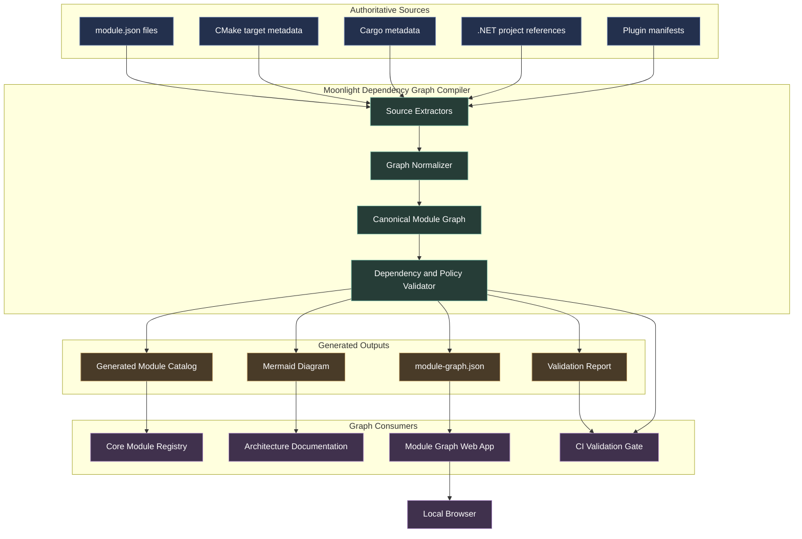
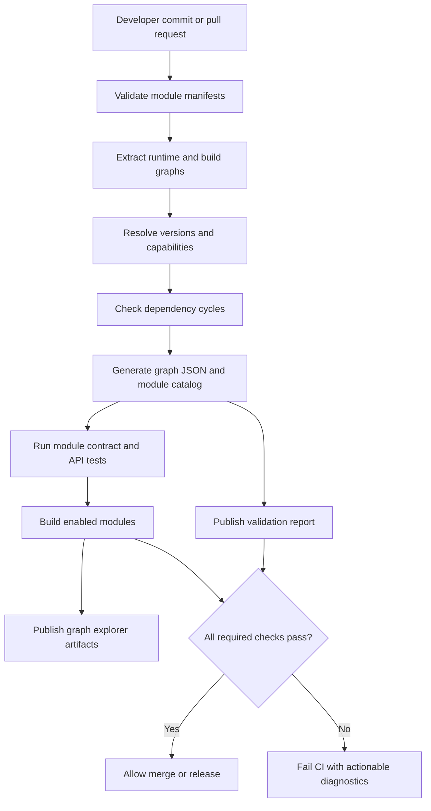

# 1. Moonlight — overall module and dependency graph

This is the high-level architecture for the complete engine. Arrows point from a consumer to the dependency it requires. The Spectral section is expanded further in the second diagram.

```mermaid

flowchart TB
    subgraph Applications["Applications"]
        WB["Workbench · C#"]
        Player["Player Runtime"]
        Headless["Headless Runner"]
        Compiler["Asset Compiler"]
        GraphWeb["Module Graph Explorer · Browser"]
    end

    subgraph Interop["Language Interoperability"]
        ManagedSDK["Moonlight Managed SDK"]
        CABI["Versioned C ABI"]
    end

    subgraph CoreLayer["Moonlight Core"]
        Core["Core Runtime API"]
        Registry["Module Registry"]
        Services["Jobs · Resources · Events · Diagnostics"]
        Platform["Platform Abstraction"]
    end

    subgraph EngineModules["Engine Modules"]
        Atlas["Atlas · ECS + Scene Graph"]
        Assets["Asset Pipeline"]
        Flywheel["Flywheel · Animation"]
        Physics["Physics"]
        Audio["Audio"]
        Input["Input"]
        Graphics["Graphics API"]
        SFoundation["Spectral Foundation"]
        SData["Spectral Data"]
        SMaterials["Spectral Materials"]
        SPath["Spectral Path Tracing"]
        SVoxel["Spectral Voxel GI"]
    end

    WB --> ManagedSDK
    ManagedSDK --> CABI
    Player --> CABI
    Headless --> CABI
    Compiler --> CABI
    CABI --> Core

    Registry --> Core
    Services --> Core
    Platform --> Core

    Atlas --> Core
    Assets --> Core
    Input --> Core
    Audio --> Core
    Physics --> Atlas
    Physics --> Core
    Flywheel --> Atlas
    Flywheel --> Assets
    Flywheel --> Core
    Graphics --> Core

    SFoundation --> Core
    SData --> SFoundation
    SData --> Assets
    SMaterials --> SFoundation
    SMaterials --> SData
    SPath --> SMaterials
    SPath --> Graphics
    SPath --> Atlas
    SVoxel --> SMaterials
    SVoxel --> Graphics
    SVoxel --> Atlas

    GraphWeb -. "reads validated graph data" .-> Core

    classDef core fill:#23304d,color:#ffffff,stroke:#7489b8
    classDef spectral fill:#263d37,color:#ffffff,stroke:#75b7a4
    classDef app fill:#40314d,color:#ffffff,stroke:#ad8bc8

    class Core,Registry,Services,Platform core
    class SFoundation,SData,SMaterials,SPath,SVoxel spectral
    class WB,Player,Headless,Compiler,GraphWeb app

```



Architecture notes: `Moonlight Core` owns the runtime and registry. The module graph is a description of dependency relationships, not a claim that all runtime services are separate dynamically loaded modules. Core services can be linked internally or exposed through service interfaces.

The `GraphWeb` relationship is a tooling relationship: the graph explorer should normally read a generated, validated graph document rather than query the live Core process. A live development mode can optionally connect to a running engine for runtime module status.

# 2. Spectral — detailed module dependency graph

This diagram shows the intended direction of dependency between Spectral's registered subsystems. Keep the core spectral data types and reference path tracer independent of the acceleration algorithms.

```mermaid

flowchart TB
    Core["Moonlight Core"]
    Atlas["Atlas · Geometry and Scene Access"]
    Assets["Moonlight Assets"]
    Graphics["Moonlight Graphics API"]

    subgraph FoundationLayer["Physical Foundation"]
        Foundation["Spectral.Foundation"]
        Data["Spectral.Data"]
    end

    subgraph MaterialLayer["Material and Interaction Physics"]
        Materials["Spectral.Materials"]
        Interfaces["Spectral.Interfaces"]
        Volumes["Spectral.Volumes"]
        Polarization["Spectral.Polarization"]
        Lighting["Spectral.Lighting"]
    end

    subgraph TransportLayer["Transport and Global Illumination"]
        Path["Spectral.PathTracing"]
        Voxel["Spectral.VoxelGI"]
        Probe["Spectral.ProbeGI"]
        Cache["Spectral.RadianceCache"]
    end

    subgraph AdvancedLayer["Advanced Optical Simulation"]
        Waves["Spectral.WaveOptics"]
        ThinFilm["Spectral.ThinFilms"]
        Diffraction["Spectral.Diffraction"]
        Maxwell["Spectral.Maxwell Solvers"]
        Transient["Spectral.Transient"]
    end

    subgraph ImageLayer["Image Formation and Validation"]
        Camera["Spectral.Camera and Sensors"]
        Colour["Spectral.ColourScience"]
        Diagnostics["Spectral.Diagnostics"]
    end

    Foundation --> Core
    Data --> Foundation
    Data --> Assets

    Materials --> Foundation
    Materials --> Data
    Lighting --> Foundation
    Lighting --> Data
    Lighting --> Assets
    Interfaces --> Foundation
    Volumes --> Foundation
    Volumes --> Materials
    Polarization --> Foundation

    Path --> Foundation
    Path --> Atlas
    Path --> Materials
    Path --> Lighting
    Path --> Interfaces
    Path --> Volumes
    Path --> Graphics

    Voxel --> Foundation
    Voxel --> Atlas
    Voxel --> Materials
    Voxel --> Lighting
    Voxel --> Graphics

    Probe --> Foundation
    Probe --> Atlas
    Probe --> Materials
    Probe --> Lighting
    Probe --> Graphics

    Cache --> Foundation
    Cache --> Atlas
    Cache --> Materials
    Cache --> Lighting
    Cache --> Graphics

    Waves --> Foundation
    Waves --> Materials
    Waves --> Interfaces
    Waves --> Polarization

    ThinFilm --> Foundation
    ThinFilm --> Interfaces
    ThinFilm --> Materials

    Diffraction --> Foundation
    Diffraction --> Waves

    Maxwell --> Foundation
    Maxwell --> Data
    Maxwell --> Atlas

    Transient --> Foundation
    Transient --> Lighting

    Camera --> Foundation
    Colour --> Foundation
    Diagnostics --> Foundation
    Diagnostics --> Core

    Waves -. "optional field-solver integration" .-> Maxwell

    classDef foundation fill:#23304d,color:#ffffff,stroke:#7489b8
    classDef transport fill:#263d37,color:#ffffff,stroke:#75b7a4
    classDef advanced fill:#493b28,color:#ffffff,stroke:#c7a56b
    classDef validation fill:#40314d,color:#ffffff,stroke:#ad8bc8

    class Foundation,Data foundation
    class Path,Voxel,Probe,Cache transport
    class Waves,ThinFilm,Diffraction,Maxwell,Transient advanced
    class Camera,Colour,Diagnostics validation

```



### Critical dependency rules

1. The reference path tracer must not depend on Voxel GI. This allows the reference renderer to serve as an independent comparison baseline.

2. Voxel GI must not own material physics. It consumes material properties and light-transport inputs, then stores an approximation of illumination in its spatial representation.

3. Wave optics and geometric transport are different execution paths. They can share material data and geometry, but phase-sensitive calculations must retain the field information they require.

4. The Maxwell solver is optional. Spectral should be usable without it. The module becomes necessary only for selected workloads requiring full-field electromagnetic calculations.

5. The graph is a design target. When implementing it, the actual `module.json` dependencies must be checked against this diagram, and any deliberate exception documented.

# 3. New enterprise tooling: Module Graph Compiler and Browser Explorer

The dependency graph should be a built-in development tool for Moonlight, not a manually maintained diagram.

The same validated module metadata should drive the Core registry catalog, build validation, generated Mermaid documentation and the interactive browser explorer. This avoids maintaining four different versions of the architecture.

## 3.1 Tooling architecture



### One important implementation detail

Keep two graph layers distinct:

- Runtime module graph: derived primarily from `module.json`, describing required and optional module dependencies, capabilities and runtime compatibility.
- Build graph: derived from CMake, Cargo and .NET build metadata, describing compile-time dependencies between targets and projects.

These graphs are related, but they are not interchangeable. A C++ library might be a build target without being a runtime module. A dynamically loaded module might declare a runtime dependency that is satisfied through a capability provider rather than a direct link.

The compiler must preserve this distinction.

## 3.2 Add these folders to the monorepo

```
moonlight/
│
├── tools/
│   └── dependency-graph/
│       ├── Cargo.toml
│       ├── README.md
│       │
│       ├── src/
│       │   ├── main.rs
│       │   ├── cli/
│       │   ├── extractors/
│       │   │   ├── module_manifest.rs
│       │   │   ├── cmake_metadata.rs
│       │   │   ├── cargo_metadata.rs
│       │   │   ├── dotnet_metadata.rs
│       │   │   └── plugin_manifest.rs
│       │   ├── graph/
│       │   │   ├── model.rs
│       │   │   ├── normalize.rs
│       │   │   ├── traversal.rs
│       │   │   └── diff.rs
│       │   ├── validation/
│       │   │   ├── duplicate_ids.rs
│       │   │   ├── missing_dependencies.rs
│       │   │   ├── cycles.rs
│       │   │   ├── version_constraints.rs
│       │   │   ├── capability_resolution.rs
│       │   │   └── architecture_policies.rs
│       │   ├── generators/
│       │   │   ├── module_catalog.rs
│       │   │   ├── mermaid.rs
│       │   │   ├── json.rs
│       │   │   └── validation_report.rs
│       │   └── server/
│       │       ├── routes.rs
│       │       └── static_files.rs
│       │
│       ├── tests/
│       │   ├── manifest_fixtures/
│       │   ├── graph_fixtures/
│       │   ├── cycle_detection.rs
│       │   └── catalog_generation.rs
│       │
│       └── docs/
│           └── graph-format.md
│
├── apps/
│   └── module-graph-web/
│       ├── package.json
│       ├── package-lock.json
│       ├── tsconfig.json
│       ├── vite.config.ts
│       ├── index.html
│       │
│       ├── src/
│       │   ├── app/
│       │   ├── components/
│       │   ├── graph/
│       │   │   ├── layout.ts
│       │   │   ├── graph-model.ts
│       │   │   ├── graph-filters.ts
│       │   │   └── graph-selection.ts
│       │   ├── views/
│       │   │   ├── interactive-graph.ts
│       │   │   ├── mermaid-view.ts
│       │   │   ├── module-details.ts
│       │   │   ├── dependency-path.ts
│       │   │   └── validation-results.ts
│       │   ├── api/
│       │   ├── styles/
│       │   └── main.ts
│       │
│       └── tests/
│
├── schemas/
│   ├── module-manifest.schema.json
│   ├── module-catalog.schema.json
│   └── module-graph.schema.json
│
├── docs/
│   └── architecture/
│       ├── module-graph.md
│       └── generated/
│           └── .gitkeep
│
└── .github/
    └── workflows/
        └── module-graph-validation.yml
```

The Rust program is the graph compiler and local server. The browser application uses TypeScript, Mermaid and an interactive graph library such as Cytoscape.js. Pin its dependencies in the lockfile.

For native build metadata, use structured build-system output wherever possible rather than attempting to parse arbitrary CMake or project files with regular expressions.

# 4. What the browser explorer should look like

The browser experience should function as an interactive architecture tool rather than merely displaying a static SVG.

## Moonlight Module Explorer

Proposed internal developer tool

Design

Search modules…

Filters

GRAPH LAYER

Runtime Dependencies

Build graph · Capabilities · Full graph

VALIDATION

Dependency Status

Missing dependencies · Cycles · Version conflicts

### Graph canvas

Moonlight Core

Runtime · Registry · Services

Atlas

Scene graph · ECS

Spectral

Rendering suite

Illustrative mock-up only. The actual browser will render nodes and edges from validated graph data.

### Selected module details

Click a node to inspect its manifest, version, source path, capabilities, required and optional dependencies, dependents, and validation results.

## Required browser capabilities

The first release should include:

- Interactive graph: pan, zoom, select, and expand modules and dependencies.
- Layer selection: switch between runtime dependencies, build dependencies, and capability relationships.
- Search and filters: find a module by ID, name, language, version, category or validation state.
- Dependency exploration: show direct dependencies, transitive dependencies, dependents and a path between two modules.
- Validation view: highlight missing modules, cycles, version conflicts, unknown capabilities and incompatible ABI versions.
- Mermaid view: render a Mermaid diagram of the selected graph or filtered subgraph.
- Export: download Mermaid source, graph JSON, SVG or PNG.
- Diff view: compare the graph between the current branch and a selected base revision to identify architecture changes.
- Live development mode: watch manifest and build-graph changes and refresh the graph automatically.

Use Cytoscape.js for the interactive graph canvas and Mermaid for the textual diagram view and documentation exports. A very large graph becomes difficult to understand as a single Mermaid diagram, so the explorer should let developers filter down to a module and its immediate dependency neighborhood.

# 5. Command-line integration

Give developers a single command group for working with the graph.

| Command | Intended behaviour |
| --- | --- |
| `moonlight graph validate` | Validate manifests, dependency constraints, capabilities and architecture policies |
| `moonlight graph build` | Generate the canonical dependency graph and module catalog |
| `moonlight graph export --format mermaid` | Export a Mermaid diagram |
| `moonlight graph export --format json` | Export the canonical graph document |
| `moonlight graph serve --watch` | Start the local browser explorer and refresh on source changes |
| `moonlight graph diff --base main` | Report dependency changes relative to the base revision |
| `moonlight module why moonlight.spectral.voxel-gi` | Explain why the selected module is included and show its dependency path |
| `moonlight module dependents moonlight.spectral.foundation` | List modules that depend on the selected module |

These are proposed command contracts; the CLI must be implemented before the commands are usable.

The local server should bind to loopback by default. If the explorer is deployed on an internal network, require the organization's normal authentication and access-control measures.

# 6. Make it part of the build and CI pipeline

The graph should be generated and validated as part of the same workflow that builds Moonlight.



The pipeline must fail when it discovers an invalid required dependency, a cycle in the required module graph, an incompatible version contract, or a stale generated module catalog. Optional dependencies should not fail validation merely because they are absent, provided their fallback behaviour is defined and validated.

Keep the generated files as build or CI artifacts unless there is a specific reason to check generated documentation into source control. If generated Mermaid diagrams are committed, CI should verify that they match the current source manifests.

## Final architecture decision

Treat the dependency graph as a generated engineering source of truth, with a canonical graph document feeding Core's module catalog, CI validation, Mermaid documentation and the interactive browser explorer.

This gives Moonlight three complementary ways to inspect its architecture: the runtime registry tells you what can be loaded, the dependency compiler tells you whether modules are structurally compatible, and the browser explorer lets developers understand and navigate the resulting system.