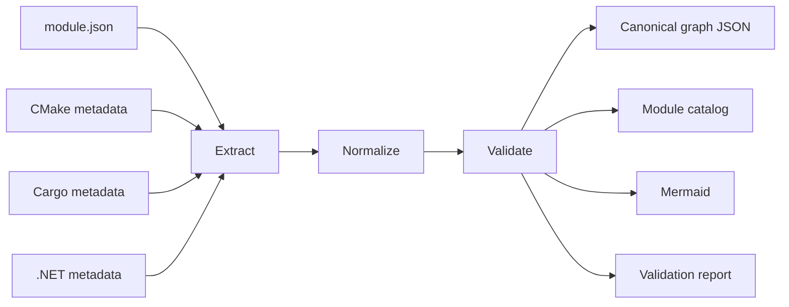

# Module graph and architecture explorer

**Status:** Design target
**Sources:** `graph-system-specification.md`, `moonlight-monorepo-architecture.md`

## Purpose

The module graph is generated engineering data, not a manually maintained
diagram. A single validated graph should feed:

- Core's module catalog.
- Runtime dependency validation.
- Build-graph diagnostics.
- Mermaid architecture documentation.
- The browser-based Module Explorer.
- CI reports and pull-request checks.

The graph must distinguish two related layers:

1. **Runtime graph** — module IDs, required and optional dependencies,
   capabilities, ABI/platform compatibility, and provider relationships.
2. **Build graph** — CMake targets, Cargo packages, .NET projects, generated
   code, and compile-time dependencies.

A CMake library is not automatically a runtime module. Conversely, a runtime
dependency may be satisfied through a capability provider without a direct
link. Every output must preserve this distinction.

## Intended compiler pipeline

The current Python CLI implements manifest discovery, manifest validation,
required-dependency lookup, cycle detection, and catalog export. The future
Rust graph compiler can add build-system extractors and a local web server
without changing the manifest contract.

## Command contract

The command family should grow toward:

| Command | Result |
| --- | --- |
| `moonlight graph validate` | Validate manifests, versions, capabilities and policies |
| `moonlight graph build` | Generate canonical graph and module catalog |
| `moonlight graph export --format mermaid` | Export a filtered Mermaid graph |
| `moonlight graph export --format json` | Export canonical graph data |
| `moonlight graph serve --watch` | Serve the local explorer and reload changes |
| `moonlight graph diff --base main` | Report graph changes against a revision |
| `moonlight module why <id>` | Explain inclusion and dependency paths |
| `moonlight module dependents <id>` | List direct and transitive dependents |

Until those subcommands are implemented, `scripts/moonlight.py validate` and
`export` remain the supported commands.

## Explorer requirements

The browser explorer should support pan, zoom, selection, search, layer
switching, transitive dependency paths, validation highlighting, Mermaid
rendering, JSON/SVG/PNG export, graph diffs, and live reload. It should read
generated graph data rather than define a second architecture model.

Large graphs must be filterable to a module neighborhood. A single unfiltered
Mermaid diagram is useful for documentation but is not a sufficient interactive
experience.

## CI policy

Graph generation happens before module tests and builds. CI fails for invalid
required dependencies, required cycles, incompatible version contracts,
unresolved required capabilities, or stale generated catalogs. Missing optional
dependencies are valid only when fallback behavior is documented and tested.
