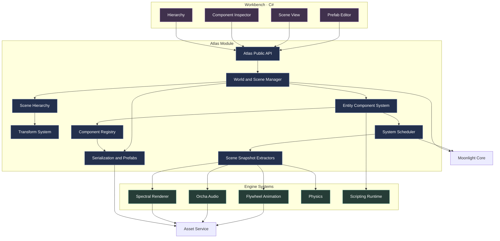
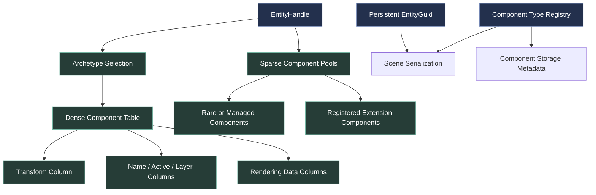
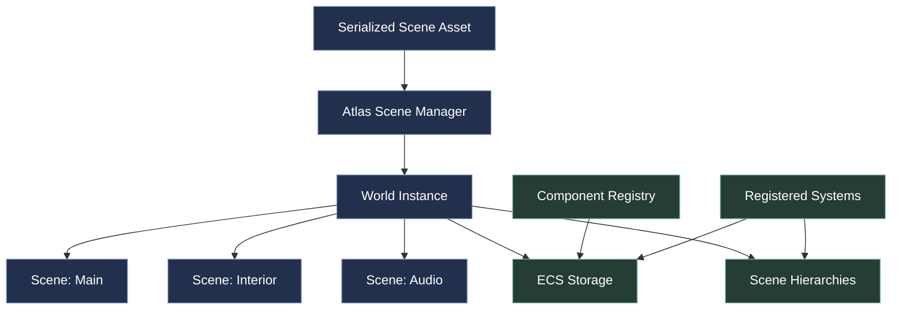
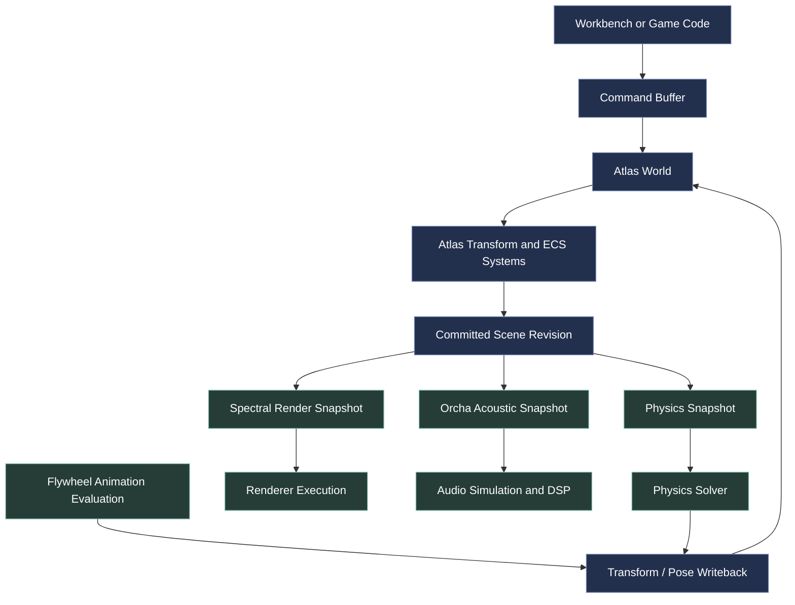

# Atlas — Scene Graph & Entity Component System

Moonlight Engine · Architecture and design specification · Version 1.0 · October 26, 2026

Atlas should be the authoritative scene and world-management module of Moonlight. It provides the Unity-like workflow of GameObjects, a Hierarchy window, a Transform component and an Inspector, while using an ECS architecture underneath for efficient queries, simulation and rendering.

Unity's GameObjects have a mandatory Transform and can carry multiple other components. Atlas should provide the same intuitive authoring model, but explicitly separate its user-facing objects from ECS storage and the internal data of rendering, audio and physics systems.

Unity Docs+1

The key rule is:

Atlas owns what exists in the world and where it is. Other modules own what those things do.

Spectral receives the geometry, materials and lights needed to render. Orcha receives the relevant sound sources, listeners, geometry and acoustic materials. Flywheel receives animation targets and skeleton references. Physics receives bodies, colliders and constraints. All of them use the same scene identity and transform conventions.

# 1. Atlas architecture at a glance



Atlas itself is registered with Moonlight Core. Its component registry also allows other modules to register new component types. This means Atlas can store an `AudioEmitter` or a rendering component without implementing audio playback or rendering itself.

## The five responsibilities of Atlas

| Subsystem | Responsibility |
| --- | --- |
| ECS | Entity identities, component storage, queries, system scheduling integration and efficient data access |
| Scene graph | Parent-child relationships and hierarchy management |
| Transform system | Local transforms, world transforms, coordinate conversions and dirty propagation |
| Scene authoring | Component editing, tags, layers, prefabs, scene loading and saving |
| Scene extraction | Produces stable, immutable scene data for rendering, audio, animation and physics consumers |

# 2. The GameObject model

Atlas should expose a familiar `GameObject` API, but a GameObject is a façade around an ECS entity, not an independently allocated object containing every feature's implementation.

## 2.1 What a GameObject looks like

## GameObject: Wooden Door

Entity GUID · Scene · Active state · Layer

Transform

Position, rotation, scale, parent and world matrix

Required

MeshRenderer

Mesh asset reference, material slots and visibility

AudioSurface

Acoustic material reference for Orcha

Collider

Collision geometry and physics filtering

DoorController

Gameplay behaviour, registered through the scripting system

This is the editor-facing view. Internally, the Transform, renderer data, acoustic properties and collider settings are independent component instances registered with Atlas. The audio, rendering, physics and scripting modules provide the functionality that consumes those components.

A GameObject can have as many compatible components as needed, and the Inspector should generate its controls from component metadata.

## 2.2 Core principles

Every GameObject has:

- One stable persistent identity.
- One runtime entity handle while it exists in a World.
- Exactly one required Transform.
- A set of zero or more additional components.
- An active state and metadata such as a name and layer.
- Optional parent and child relationships.
- Membership in a Scene and World.

A GameObject is not required to have a mesh, renderer, camera or audio source. Empty GameObjects are essential for grouping, attachment points, gameplay logic, animation rigs and organizational structure.

## 2.3 Three identities, three purposes

Atlas should not use one integer to serve every identity requirement.

| Identifier | Purpose |
| --- | --- |
| `EntityGuid` | Persistent identity across saving, loading, prefab instances and scene revisions |
| `EntityHandle` | Efficient runtime reference, typically an index plus generation |
| `ComponentTypeId` | Stable ID of a component schema registered by a module |

The runtime handle prevents stale references from accidentally resolving to a newly created entity that reuses an old slot. The GUID is used for persistence and asset references, not for hot-loop queries.

This is consistent with established ECS designs in which entities are lightweight identifiers and components contain the data.

Flecs+1

# 3. Folder structure for the Atlas module

Atlas should have its own dedicated folder under `modules/atlas/`. Its internal subdirectories should separate ECS implementation, scene hierarchy, transforms, component registration, serialization, system scheduling and extraction.

```
modules/atlas/
│
├── README.md
├── module.json
├── CMakeLists.txt
├── CHANGELOG.md
│
├── include/moonlight/atlas/
│   │
│   ├── api/
│   │   ├── atlas_api.hpp
│   │   └── atlas_version.hpp
│   │
│   ├── ecs/
│   │   ├── entity_guid.hpp
│   │   ├── entity_handle.hpp
│   │   ├── component_type_id.hpp
│   │   ├── component_registry.hpp
│   │   ├── component_view.hpp
│   │   ├── query.hpp
│   │   ├── world_registry.hpp
│   │   └── command_buffer.hpp
│   │
│   ├── scene/
│   │   ├── world.hpp
│   │   ├── scene.hpp
│   │   ├── scene_handle.hpp
│   │   ├── scene_settings.hpp
│   │   └── scene_revision.hpp
│   │
│   ├── hierarchy/
│   │   ├── hierarchy.hpp
│   │   ├── hierarchy_view.hpp
│   │   └── hierarchy_commands.hpp
│   │
│   ├── transform/
│   │   ├── transform_component.hpp
│   │   ├── transform_system.hpp
│   │   ├── transform_snapshot.hpp
│   │   └── coordinate_conversion.hpp
│   │
│   ├── components/
│   │   ├── identity.hpp
│   │   ├── name.hpp
│   │   ├── active_state.hpp
│   │   ├── layer_mask.hpp
│   │   └── tags.hpp
│   │
│   ├── reflection/
│   │   ├── component_descriptor.hpp
│   │   ├── field_descriptor.hpp
│   │   ├── component_factory.hpp
│   │   └── component_metadata.hpp
│   │
│   ├── systems/
│   │   ├── system.hpp
│   │   ├── system_descriptor.hpp
│   │   ├── system_phase.hpp
│   │   └── system_scheduler.hpp
│   │
│   ├── extraction/
│   │   ├── scene_snapshot.hpp
│   │   ├── snapshot_revision.hpp
│   │   ├── extraction_context.hpp
│   │   └── extraction_registry.hpp
│   │
│   ├── serialization/
│   │   ├── scene_serializer.hpp
│   │   ├── component_serializer.hpp
│   │   ├── schema_migration.hpp
│   │   └── prefab_serializer.hpp
│   │
│   ├── prefabs/
│   │   ├── prefab_asset.hpp
│   │   ├── prefab_instance.hpp
│   │   └── prefab_overrides.hpp
│   │
│   ├── events/
│   │   ├── entity_events.hpp
│   │   ├── component_events.hpp
│   │   └── scene_events.hpp
│   │
│   └── diagnostics/
│       ├── atlas_error.hpp
│       ├── scene_validation.hpp
│       └── entity_debug_info.hpp
│
├── src/
│   ├── module_entry.cpp
│   │
│   ├── ecs/
│   │   ├── entity_allocator.cpp
│   │   ├── archetype_storage.cpp
│   │   ├── sparse_component_storage.cpp
│   │   ├── query_executor.cpp
│   │   ├── command_buffer.cpp
│   │   └── component_registry.cpp
│   │
│   ├── scene/
│   │   ├── world.cpp
│   │   ├── scene.cpp
│   │   ├── scene_manager.cpp
│   │   └── scene_revision.cpp
│   │
│   ├── hierarchy/
│   │   ├── hierarchy.cpp
│   │   ├── hierarchy_validation.cpp
│   │   └── hierarchy_commands.cpp
│   │
│   ├── transform/
│   │   ├── transform_system.cpp
│   │   ├── world_transform_cache.cpp
│   │   └── transform_propagation.cpp
│   │
│   ├── reflection/
│   ├── systems/
│   ├── extraction/
│   ├── serialization/
│   ├── prefabs/
│   ├── events/
│   └── diagnostics/
│
├── schemas/
│   ├── scene.schema.json
│   ├── prefab.schema.json
│   └── component-manifest.schema.json
│
├── tests/
│   ├── unit/
│   │   ├── entity-lifecycle/
│   │   ├── component-storage/
│   │   ├── queries/
│   │   ├── transforms/
│   │   └── hierarchy/
│   │
│   ├── integration/
│   │   ├── serialization/
│   │   ├── prefabs/
│   │   ├── scene-loading/
│   │   └── cross-module-extraction/
│   │
│   ├── contracts/
│   │   ├── module-registry/
│   │   ├── component-registration/
│   │   └── snapshot-lifetime/
│   │
│   └── failure/
│       ├── stale-handles/
│       ├── invalid-hierarchy/
│       ├── missing-components/
│       └── schema-migration/
│
├── benchmarks/
│   ├── entity-creation/
│   ├── component-queries/
│   ├── transform-propagation/
│   ├── scene-loading/
│   └── snapshot-extraction/
│
├── docs/
│   ├── architecture.md
│   ├── ecs-storage.md
│   ├── scene-hierarchy.md
│   ├── component-authoring.md
│   ├── serialization.md
│   ├── prefab-system.md
│   ├── threading.md
│   └── module-integration.md
│
└── examples/
    ├── minimal-scene/
    ├── custom-component/
    ├── custom-system/
    └── scene-extraction/
```

This is the target architecture. You do not need to implement every directory in the first iteration. Start with entities, component storage, the mandatory Transform, scene hierarchy, serialization, component registration and scene extraction.

# 4. ECS storage design

Atlas should use a hybrid ECS storage architecture: dense archetype-based storage for hot component combinations, plus sparse component pools for types that are less frequently queried or unsuitable for archetype migration.

An archetype groups entities according to their component composition. Systems can then process component columns efficiently. Sparse storage is useful for optional or irregularly accessed components.

This avoids both extremes: an entirely object-oriented structure with a separate allocation for every component, and a rigid data-oriented implementation that makes editor workflows or extensibility difficult.

## 4.1 Data layout



The exact storage policy should be selected when a component type is registered. A component's C++ memory layout must not become part of the persistent scene format.

## 4.2 Component registry

Every component needs a stable descriptor containing:

- Component type ID and schema version.
- Display name and category.
- Storage policy.
- Field metadata for Workbench.
- Serialization and deserialization functions.
- Validation rules.
- Optional migration functions.
- Dependency or exclusion constraints.
- Debug and inspection metadata.

A module can register a new component without modifying the core Atlas source. Atlas then provides storage, entity attachment, querying and lifecycle management.

If a plugin is missing when a scene is loaded, Atlas should preserve the serialized component payload as an unresolved component record instead of silently deleting it. Once the owning module returns, the payload can be validated and restored.

## 4.3 Entity lifecycle

Runtime entity handles should use generation counters to prevent stale references from becoming valid after slot reuse.

Creation, destruction and structural changes should be mediated by Atlas's ECS API. Systems should not retain unchecked pointers to component storage across operations that can move or destroy components.

When a job requires a structural change while another system is iterating a query, use a deferred command buffer and apply the changes at a defined synchronization point.

This is particularly important when thousands of entities are updated concurrently.

# 5. Scene graph and transform system

Atlas's hierarchy should be a strict parent-child tree for spatial objects. Every entity has at most one parent, and the system rejects cycles. This matches the strict-tree model used by glTF's node hierarchy and makes transform propagation and asset interchange predictable.

GitHub+1

## 5.1 Local and world transforms

Each entity has a local transform defined relative to its parent:

\[
\mathbf M_{\mathrm{world}}
=
\mathbf M_{\mathrm{parent}}
\mathbf M_{\mathrm{local}}
\]

For a root entity:

\[
\mathbf M_{\mathrm{world}}=\mathbf M_{\mathrm{local}}
\]

The local transform consists of translation, quaternion rotation and scale, represented as a matrix when needed.

The order and convention must be defined centrally. Atlas should choose a consistent coordinate system; a right-handed, Y-up convention with metres and radians is an interoperable option because it matches glTF's coordinate and unit conventions.

GitHub+1

## 5.2 Transform data contract

```
struct LocalTransform
{
    Vector3 translationMeters;
    Quaternion rotation;
    Vector3 scale{1.0f, 1.0f, 1.0f};
};

struct WorldTransform
{
    Matrix4x4 matrix;
    Matrix3x3 normalMatrix;
    std::uint64_t revision;
};
```

These are illustrative C++ types. A production implementation should specify precision, quaternion normalization, matrix layout, invalid-scale handling and numerical tolerances.

The `normalMatrix` is derived data used by rendering consumers. Atlas may calculate and cache it, or a rendering extractor may calculate it when the transform snapshot is built.

### Required transform behaviour

- Moving a parent updates its descendants' world transforms.
- Moving a child does not change its parent's transform.
- Reparenting can either preserve local position or preserve world position.
- Cycles and invalid parent handles are rejected.
- Transform changes mark affected descendants dirty.
- Repeated reads of an unchanged transform do not unnecessarily recalculate the entire subtree.
- World matrices are calculated according to the declared transform convention.

Nonuniform scale combined with rotation can introduce shear into a world matrix. Atlas should preserve the full derived matrix where needed rather than repeatedly decomposing it into TRS values and losing information.

## 5.3 Hierarchy storage

Store parent-child relationships in a dedicated hierarchy structure. Do not force the editor to traverse ECS component storage just to draw the Hierarchy panel.

Conceptually:

```
struct HierarchyNode
{
    EntityHandle parent;
    EntityHandle firstChild;
    EntityHandle nextSibling;
    std::uint32_t childCount;
};
```

A different layout may be selected after profiling, but the contract remains: each spatial entity has at most one parent, hierarchy mutation is validated, and children can be enumerated efficiently.

This hierarchy supports grouping, transform inheritance, parented objects, attachment points, character rigs and prefab instances.

# 6. Component catalogue: what lives on GameObjects?

Atlas should own the storage and registration mechanisms. Component schemas can be registered by Atlas itself or by domain modules that need them.

This ownership rule is crucial: Atlas stores scene state; Spectral, Orcha, Flywheel and Physics interpret and simulate their respective component data.

## 6.1 Core Atlas components

These are built into Atlas because every scene and every system benefits from them.

| Component | Purpose |
| --- | --- |
| `Transform` | Required local transform and hierarchy integration |
| `Name` | Human-readable name shown in Workbench |
| `ActiveState` | Whether the entity is active, plus derived hierarchy-active state |
| `LayerMembership` | Layer masks used by filtering and editor workflows |
| `TagSet` | Lightweight semantic labels for lookup and gameplay |
| `PrefabInstance` | Reference to prefab source and instance overrides |
| `EditorMetadata` | Optional editor-only visibility, locking and selection hints |

Editor-only metadata should not automatically be included in the packaged runtime. The build pipeline must explicitly decide which fields are authoring-only and which are runtime-relevant.

## 6.2 Rendering components

The following schemas describe renderable scene data. They can be registered by a rendering-component package, while Atlas stores their component instances.

| Component | Data |
| --- | --- |
| `MeshRenderer` | Mesh asset ID, material-slot references, visibility, render-layer flags |
| `Camera` | Projection type, clipping planes, field of view or orthographic settings |
| `LightSource` | Light type, physical or explicitly artistic power settings, direction, spectrum reference |
| `ReflectionCapture` | Optional capture volume and update policy |
| `SkyEnvironment` | Environment asset, rotation and illumination settings |
| `DecalRenderer` | Decal material, bounds and projection parameters |
| `VisibilityBounds` | Bounds used for visibility culling and scene extraction |

Avoid making `MeshRenderer` store Spectral's GPU objects. It should contain references to asset IDs and serializable settings. Spectral resolves the assets and builds render-side structures.

Light parameters should also distinguish physically defined radiant quantities from artist-authored intensity controls. Spectral can interpret those settings according to the selected rendering profile.

## 6.3 Audio components

Orcha can register the following scene components:

| Component | Data |
| --- | --- |
| `AudioEmitter` | Sound-event or audio-asset ID, gain, looping, directivity and playback parameters |
| `AudioListener` | Listener identity, orientation source and output spatialization profile |
| `AcousticSurface` | Reference to an acoustic material or an assigned acoustic material slot |
| `AcousticPortal` | Portal geometry and connectivity between acoustic zones |
| `AcousticZone` | Zone membership and environment or room-response settings |
| `AudioOcclusionProxy` | Optional acoustic geometry override for simplified collision surfaces |

Atlas stores these values; Orcha performs playback and acoustic simulation. A mesh renderer and acoustic surface may refer to the same entity geometry, but their material descriptions remain distinct because visual and acoustic material properties describe different physical phenomena.

## 6.4 Physics components

Physics should own the component definitions associated with its simulation model.

| Component | Purpose |
| --- | --- |
| `RigidBody` | Mass, inertia, body type and dynamic-state configuration |
| `Collider` | Collision-shape asset or shape parameters |
| `Joint` | Relationship and constraints between physical bodies |
| `CharacterController` | Controlled movement and collision settings |
| `PhysicsMaterial` | Friction, restitution and related contact properties |

The physics module extracts these components into its solver representation and returns updated poses through a defined synchronization contract.

## 6.5 Animation and scripting components

| Component | Owner | Purpose |
| --- | --- | --- |
| `Animator` | Flywheel | Animation graph, playback state and parameters |
| `SkeletonReference` | Flywheel | Skeleton asset and associated pose data |
| `SkinDeformer` | Flywheel / rendering integration | Skinned mesh and joint palette references |
| `ScriptAttachment` | Scripting module | Script asset reference and serialized instance data |
| `BehaviourState` | Scripting module | Runtime-specific behaviour state if it needs explicit ECS representation |

These are examples of the extension model, not a requirement that every component lives in Atlas's own implementation directory.

# 7. How external modules register components

Atlas should expose a registration API capable of describing new component types and their fields to Core, Workbench and the serializer.

A simplified descriptor could look like this:

```
struct ComponentFieldDescriptor
{
    FieldId id;
    std::string_view name;
    FieldType type;
    FieldFlags flags;
};

struct ComponentDescriptor
{
    ComponentTypeId id;
    std::uint32_t schemaVersion;
    std::string_view name;
    StoragePolicy storagePolicy;

    Span<const ComponentFieldDescriptor> fields;

    ComponentValidationFn validate;
    ComponentSerializeFn serialize;
    ComponentDeserializeFn deserialize;
};
```

In production, the string and field lifetimes must be owned by a registered descriptor package or another documented lifetime contract. `FieldType` and `FieldFlags` should be stable reflected enums, and the serializer must not depend on a compiler-specific object layout.

A Spectral component registration could provide a `MeshRenderer` schema. Atlas registers its type ID and storage policy, Workbench discovers the field metadata and generates Inspector controls, and Spectral registers an extraction handler to consume the component when building a render snapshot.

This avoids placing renderer-specific implementation details inside the Atlas ECS core.

# 8. Scene, World and World Instance

Atlas should distinguish between a scene asset and a running World.

A scene asset is the serialized authoring description: entities, components, hierarchy, references and scene settings.

A World is the runtime state in which systems process entities and components. It may contain one or more loaded scenes.

This separation allows the editor to preserve an authoring scene while the player runs a separate instance of the same scene.

## 8.1 Scene architecture



A World can contain multiple scenes when the game uses additive loading or streamed environments. Each entity must belong to a defined scene, and scene unloading must clean up the entities and resources associated with it according to explicit ownership rules.

A single entity should not simultaneously belong to two unrelated scene hierarchies. Moving an entity between scenes must be a deliberate operation, not an accidental side effect of parenting.

## 8.2 Scene settings

Each scene should be able to hold:

- Persistent scene identity and version.
- Root entity list and hierarchy.
- Environment and default scene configuration references.
- Entity and component records.
- Layer and tag definitions or references to project-level definitions.
- Streaming and loading metadata.
- Optional render, physics and acoustic environment settings via module-owned schema extensions.

Atlas does not need to understand every environment setting. It stores registered, versioned component or scene-extension data and lets the owning module interpret it.

# 9. Serialization, prefabs and asset references

A production engine needs reliable scene persistence. Atlas should support versioned scene files, prefab assets, nested prefab instances, overrides, deterministic loading and schema migration.

## 9.1 Proposed file layout

```
GameProject/
├── Scenes/
│   ├── Main.moonscene
│   └── Interior.moonscene
│
├── Prefabs/
│   ├── Characters/
│   │   └── Player.moonprefab
│   ├── Environment/
│   │   └── WoodenDoor.moonprefab
│   └── Lighting/
│       └── Lamp.moonprefab
│
├── Assets/
│   ├── Meshes/
│   ├── Materials/
│   ├── Textures/
│   ├── Audio/
│   └── Animation/
│
└── Project/
    ├── project.moonproject
    └── asset-catalog.json
```

The `.moonscene` and `.moonprefab` extensions are proposed Moonlight conventions.

Scene files should use stable GUIDs for asset references instead of absolute paths or raw in-memory pointers. The format should be versioned and migrate older scenes through explicit schema migrations.

glTF should be supported as an import/export format for geometry-focused scene content. Its hierarchy, mesh, material, camera and animation constructs provide a useful interoperability baseline, but Moonlight-specific components such as Orcha acoustic zones will require extensions or separate scene data.

Runtime 3D Asset Delivery+1

## 9.2 Prefab workflow

A prefab is a reusable entity hierarchy with component data and asset references.

Atlas should support:

- Creating a prefab from a selection of entities.
- Instantiating it with fresh entity handles and stable per-instance identities.
- Nested prefabs.
- Instance overrides.
- Applying selected overrides back to the prefab asset.
- Reverting overrides.
- Detecting deleted or changed fields after a prefab schema update.
- Validating all referenced assets when loading.

Prefab expansion should preserve the original prefab asset identity and separately record instance modifications. Avoid duplicating prefab content with no link to its source, because that makes large-scale content maintenance difficult.

## 9.3 Missing modules and data preservation

If a scene contains a component whose plugin is not installed, Atlas should retain the raw versioned component record, show it as unresolved in Workbench and allow the rest of the scene to load where safe.

It should not silently omit the component on save. Otherwise, opening a project on a machine with a missing plugin could permanently destroy project data.

# 10. The scene snapshot pipeline

This is the most important cross-module design decision for Moonlight.

Atlas owns authoritative scene state. Rendering, audio and physics receive read-only, revisioned snapshots containing the information each system needs. They should not each reinterpret editable objects independently on arbitrary threads.

## 10.1 Data flow



Snapshots should identify the scene revision, world revision, frame number and transform revision they represent. A consumer that receives stale data can reject it or update it, depending on the requirements of the current frame.

## 10.2 Spectral extraction

The render extractor gathers:

- Mesh and geometry asset handles.
- World transforms and normal transforms.
- Material slot references.
- Visibility and render-layer flags.
- Camera state.
- Light descriptions.
- Skinning and deformation references.
- Environment and reflection-capture settings where supported.

It then constructs the render-side scene representation used by Spectral. Spectral can build acceleration structures and GPU resources from this snapshot without accessing Workbench's editable data structures.

## 10.3 Orcha extraction

The audio extractor gathers:

- Audio emitter and listener configuration.
- Source and listener transforms.
- Acoustic geometry.
- Acoustic material references.
- Room, portal and acoustic-zone data.
- Static/dynamic status of geometry relevant to acoustic acceleration structures.

Orcha creates its own acoustic scene representation from the common source data. It should not require GPU rendering resources just to trace acoustic paths.

## 10.4 Physics and animation synchronization

Physics and animation need explicit rules for who can write transform state and when.

For example, Flywheel may calculate skeletal poses and a kinematic controller may update a character position. Physics then simulates bodies and can write authoritative rigid-body transforms back into Atlas at a defined synchronization point.

Avoid allowing several systems to write the same transform arbitrarily. The system scheduler should declare write ownership, dependencies and synchronization phases.

# 11. System scheduling and threading

Atlas needs a clear frame lifecycle. ECS queries may run in parallel when their data access is independent, but structural changes must be coordinated.

A recommended frame sequence is:

1. Apply queued external and editor commands.
2. Update local transforms and dirty hierarchy branches.
3. Run gameplay and scripting updates.
4. Evaluate animation through Flywheel.
5. Run physics at its configured fixed timestep.
6. Apply physics writeback and resolve transform consistency.
7. Commit the scene revision for downstream consumers.
8. Build or incrementally update render and audio snapshots.
9. Execute rendering, acoustic simulation and other read-only consumers asynchronously.
10. Merge the permitted asynchronous outputs at their defined synchronization points.

The exact order between gameplay, animation and physics will depend on their declared dependencies and the chosen simulation policy. Atlas should express those dependencies explicitly rather than hard-coding all systems in one monolithic update function.

### Scheduling contracts

Each system should declare:

- Its update phase.
- Component types it reads.
- Component types it writes.
- Whether it may change the hierarchy.
- Whether it may perform structural ECS changes.
- Its required upstream systems.
- Whether it may execute in parallel.

Use deferred command buffers for entity creation, destruction, component addition and removal during parallel iteration. Use immutable snapshots for render and audio readers.

This provides a safer foundation for multithreaded simulation and makes runtime bugs easier to reproduce.

# 12. Public APIs for C++ and C#

Atlas should expose a native C++ API for engine modules, a versioned C ABI for stable cross-language interoperation, and a managed wrapper for Workbench.

A simplified C++ façade could look like:

```
namespace Moonlight::Atlas
{
    class GameObject
    {
    public:
        EntityGuid Guid() const;
        bool IsValid() const;
        bool IsActive() const;

        LocalTransform GetLocalTransform() const;
        WorldTransform GetWorldTransform() const;

        Result<void> SetParent(
            EntityHandle parent,
            ParentTransformMode mode);

        template<typename T, typename... Args>
        Result<T&> AddComponent(Args&&... args);

        template<typename T>
        T* TryGetComponent();
    };
}
```

This is an illustrative API sketch. The implementation should specify ownership, entity/world validity, error reporting, reference lifetime and thread restrictions. Avoid holding `T&` or component pointers across structural changes; production APIs may prefer short-lived component views or handles.

Workbench can then provide a corresponding managed experience, including `GameObject` selection, component inspection and transactional editing, without exposing C++ object layouts directly.

## 12.1 Editor operations must be transactional

Every Inspector change should go through an Atlas command or edit transaction. This lets the editor support undo/redo, dirty tracking, prefab overrides and validation.

Examples include:

- Change an object's transform.
- Add a MeshRenderer component.
- Assign a material asset.
- Reparent a child object while preserving its world transform.
- Move entities between scenes.
- Instantiate or revert a prefab.

The editor should not directly mutate ECS internals. The same command APIs can also support scripting tools, automated scene generation and future collaborative editing.

# 13. Performance, diagnostics and validation

Atlas must remain efficient for scenes with many entities and high component counts, while still supporting the rich authoring model of an editor.

## Performance targets to measure

Do not commit to arbitrary universal entity-count promises. Define benchmark workloads covering:

- Entity creation and destruction.
- Archetype migration.
- Sparse component lookup.
- Hot ECS queries.
- Transform propagation through deep hierarchies.
- Large flat and nested scene graphs.
- Scene load/save time.
- Prefab instantiation.
- Snapshot extraction cost.
- Allocation count during steady-state frame updates.
- Multi-threaded job scheduling overhead.

Each benchmark should run on declared hardware and compiler configurations so regressions are measurable.

## Diagnostic tools

Atlas should also expose:

- Hierarchy cycle and invalid-parent detection.
- Stale entity-handle detection.
- Component schema and serialization errors.
- Missing asset reference reports.
- Duplicate persistent GUID detection.
- Transform dirty-region visualizers.
- ECS archetype and component-pool inspection.
- Query performance and component-count statistics.
- Snapshot revision and extraction timing.
- System dependency and scheduling graph.
- Entity and component lifetime tracing in development builds.

Integrate Atlas with Moonlight's dependency-graph tool, so module dependencies and component ownership can be inspected alongside runtime system scheduling.

# 14. Development roadmap

1. Foundation: ECS and Transform

    Implement stable entity identifiers, component registration, mandatory Transform, hierarchy validation, world-transform propagation and basic queries.

2. World and scene serialization

    Implement scene loading and saving, versioned component serialization, GUID-based asset references, schema migration and a functional Scene Manager.

3. Workbench GameObject workflow

    Integrate Hierarchy, Inspector, entity selection, undo/redo, prefab instances and component registration from modules.

4. Rendering integration

    Register render-related component schemas and build the Spectral snapshot extractor. Validate static and moving objects, multiple materials, cameras and lights.

5. Audio and physics integration

    Implement Orcha's acoustic snapshot and physics extraction pipeline with shared geometry, revision tracking and explicit transform writeback.

6. Animation and multithreading

    Integrate Flywheel's pose evaluation, job scheduling, command buffers, concurrency validation and immutable scene snapshots.

7. Enterprise hardening

    Add performance regression tests, failure recovery, component migrations, unresolved-component preservation, asset validation and stable cross-language APIs.


## Final architectural decision

Atlas is not merely a tree of GameObjects. It is Moonlight's shared scene database and runtime world model, presented through a familiar Unity-like component workflow.

Its ECS stores the components, its hierarchy maintains parent-child structure, its transform system establishes spatial relationships, and its snapshot pipeline gives each engine subsystem a consistent view of the world.

That separation will let Spectral and Orcha evolve independently while rendering and simulating the same scene—without maintaining duplicate worlds or forcing the core Atlas implementation to depend on every future engine feature.