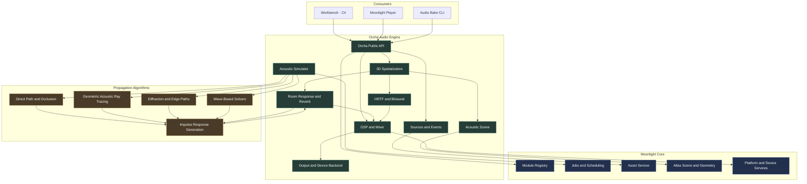
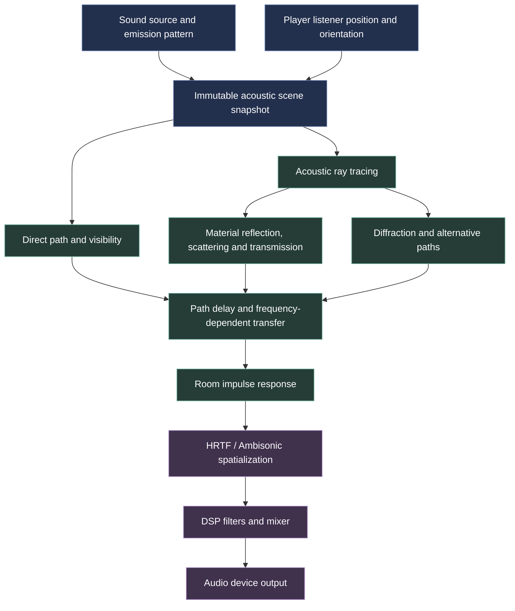
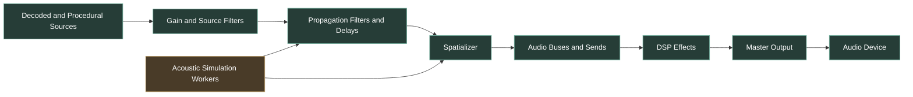
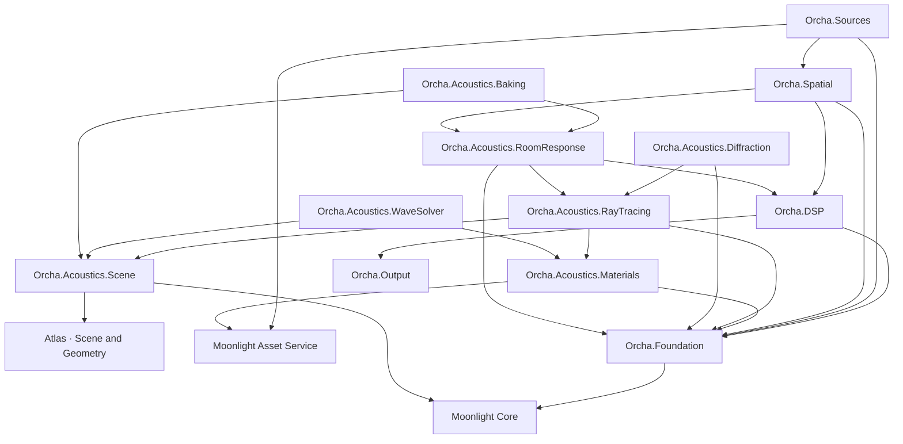

# Orcha — Enterprise Acoustic Simulation & Audio Engine

Moonlight Engine · Audio module design specification · Version 1.0 · October 26, 2026

Orcha should be Moonlight's complete audio subsystem: a physically grounded 3D audio engine with geometric acoustic ray tracing, realistic sound obstruction and muffling, room acoustics, reflections, diffraction, reverberation, positional audio and a professional audio production pipeline.

The core requirement is that the sound heard by the player should be determined by the sound source, the actual environment, the materials between the source and listener, and the listener's position and orientation—not just by a manually configured volume curve.

One important physical distinction shapes the entire architecture: ordinary acoustic ray tracing is very useful for reflections and propagation through complex spaces, but it does not exactly solve every wave phenomenon. Low-frequency diffraction, room modes, phase-sensitive interference and structural vibration can require wave-based or other specialized solvers. Modern spatial-audio systems already combine geometric simulation, material-dependent transmission, reflections and pathing; Orcha should build on these established principles rather than assume that rays alone are a complete wave simulation.

Steamworks+2

## 1. Product vision

## Orcha.Acoustics

Physical sound propagation

Simulates direct sound, reflections, diffraction approximations, transmission through materials, atmospheric absorption, occlusion and room response.

## Orcha.Spatial

3D perception and localization

Binaural HRTF rendering, head tracking, source directivity, distance cues, surround sound, Ambisonics and spatial mixing.

## Orcha.DSP

Audio processing and signal engine

Low-latency mixing, filtering, convolution, equalization, dynamics, effects, resampling, routing and output-device management.

## Orcha.Sources

Audio assets and sound emitters

Sound events, voices, music, environmental ambience, procedural synthesis, source directivity, looping and voice prioritization.

## Orcha.Workbench

Audio authoring and diagnostics

Acoustic materials, source/listener visualizers, ray-path inspection, impulse-response baking, profiling, sound-event authoring and validation.

Orcha should support both real-time game audio and offline acoustic simulation. Interactive gameplay needs predictable latency, bounded CPU use and continuously updated sound paths. Offline simulation can spend substantially more computation on reflections, detailed room responses, validation and high-quality convolution.

These modes should share the same scene geometry, acoustic material definitions and physical conventions, even when their algorithms differ.

# 2. Architecture and module boundaries

Orcha should be organized as a suite of registered modules, following the same conventions as Spectral. Its root directory aggregates the subsystem, while each independently replaceable component has its own manifest, API, implementation and tests.

The principal division is between audio rendering, acoustic simulation, and audio content management. They interact through explicit contracts rather than being combined into one huge audio class.



A few dependencies deserve special attention.

- Atlas provides scene geometry and transforms. Orcha can use a specialized acoustic acceleration structure built from the same scene data.
- Core's job system runs simulations away from the audio callback. The real-time audio thread must never block while waiting for ray tracing, asset loading or a room-response bake.
- DSP consumes simulation results. Acoustic simulation calculates delays, gains, filters and room responses; DSP renders them into the output stream.
- The wave solver is optional. Most games can run without it, while demanding acoustic experiments can explicitly enable it.
- Workbench is a client, not a dependency of the runtime. Packaged games must not require the editor.

The architectural approach is consistent with established spatial-audio systems that separate simulation settings, scene geometry, source/listener inputs, and the resulting DSP effects.

GitHub+1

# 3. The physical acoustic model

## 3.1 Sound is a pressure wave

For ordinary game-audio applications, Orcha begins with linear acoustics: small pressure variations propagating through an otherwise stationary medium.

In a homogeneous, lossless fluid, acoustic pressure \(p'(\mathbf x,t)\) satisfies the wave equation:

\[
\nabla^2 p'(\mathbf x,t)
-\frac{1}{c^2}
\frac{\partial^2p'(\mathbf x,t)}{\partial t^2}=0
\]

where \(c\) is the speed of sound.

For a fluid with density \(\rho\) and appropriate adiabatic bulk modulus \(K_s\):

\[
c=\sqrt{\frac{K_s}{\rho}}
\]

The wavelength associated with a sinusoidal component of frequency \(f\) is:

\[
\lambda=\frac{c}{f}
\]

This is why different acoustic techniques are needed for different frequencies. At lower frequencies, sound wavelengths can be comparable to room dimensions; at higher frequencies, many room features are large compared with the wavelength.

## 3.2 What an acoustic ray represents

An acoustic ray represents an approximate path along which sound energy travels. It is not a complete representation of the pressure wave.

Orcha should therefore provide three propagation regimes.

Regime A — Geometric acoustic transport

Use ray casting, ray tracing, image-source methods and statistical path tracing for direct sound, visibility, reflections and suitable reverberation estimates. This is the main real-time workhorse.

Regime B — Hybrid diffraction and wave-aware acoustics

Add edge diffraction, portal pathing, waveguide approximations and low-frequency corrections where geometric acoustics is insufficient. Use specialized algorithms with explicit validity limits.

Regime C — Numerical wave simulation

Solve the acoustic wave equation in selected domains using methods such as finite-difference time-domain (FDTD), finite-element methods (FEM) or boundary-element methods (BEM), where appropriate. This is primarily an offline or specialist mode.

Meta's acoustic ray-tracing documentation describes geometry-based simulation of reflections, reverberation, occlusion and diffraction. That is a useful reference for Orcha's interactive mode, but a complete physical wave solution still requires the correct solver for the problem at hand.

Meta Horizon OS Developers+1

## 3.3 Sound travelling from a source to a player

The simulation is centered on a listener at the player's ears or head, not on the player object's origin by default. Each sound source has its own position, orientation, emission pattern and signal.

The runtime should:

1. Read the source and listener transforms from Atlas.
2. Find direct sound paths and test visibility.
3. Calculate direct-path propagation delay, distance loss, air absorption and material transmission.
4. Trace reflected paths and estimate their frequency-dependent energy and arrival directions.
5. Search for diffraction paths when line of sight is blocked and that model is enabled.
6. Build or update a representation of the acoustic impulse response.
7. Spatialize direct and reflected sound for the listener.
8. Mix the result with music, dialogue, ambience and other audio buses.

The acoustic simulator can trace paths forward from sources, backward from the listener, or use a hybrid method. These choices affect performance and sampling efficiency; they do not change the underlying physical model.

# 4. The equations Orcha should implement

## 4.1 Free-field distance attenuation

For an ideal point source in a free field, energy spreads over the surface of a sphere. Consequently:

\[
I(r)\propto \frac{1}{r^2}
\]

For the corresponding acoustic pressure amplitude in the far field:

\[
|p(r)|\propto\frac{1}{r}
\]

The free-field sound-pressure-level difference between distances \(r_1\) and \(r_2\) is:

\[
\Delta L_p=-20\log_{10}\left(\frac{r_2}{r_1}\right)
\]

This applies under suitable free-field assumptions. Room reflections, source directivity, near-field effects and obstructions can make the actual result differ.

For calibrated output, use the sound-pressure level definition:

\[
L_p=20\log_{10}
\left(\frac{p_{\mathrm{rms}}}{20\,\mu\mathrm{Pa}}\right)
\]

for the conventional reference pressure in air.

Orcha's distance model should be derived from the selected source model and physical conditions, with artistic attenuation curves offered as an explicit override—not silently substituted for physical propagation.

## 4.2 Material reflection and transmission

Acoustic materials require frequency-dependent properties. A wall is not described sufficiently by a single "muffling" scalar.

At normal incidence between idealized media with real characteristic acoustic impedances \(Z_1\) and \(Z_2\), the pressure reflection coefficient is:

\[
r_p=\frac{Z_2-Z_1}{Z_2+Z_1}
\]

The reflected energy fraction is:

\[
R=|r_p|^2
\]

For an opaque boundary where no other energy pathway is present, the absorbed fraction is:

\[
\alpha=1-R
\]

For a boundary that transmits energy, the energy balance must also include the transmitted fraction:

\[
\alpha+R+T=1
\]

This simple balance assumes an appropriate passive boundary model with all relevant outgoing channels accounted for. Real surfaces may require complex impedance, angle-dependent scattering, multilayer transfer calculations or measured data.

Orcha's acoustic material must therefore describe its absorption, scattering, transmission and relevant physical structure. The engine should use measured frequency-dependent data or validated physical models whenever available.

## 4.3 Real muffling through a wall

When sound travels through a wall, its transmitted sound should be filtered according to the wall's acoustic transmission response.

Define transmission loss as:

\[
TL(f)=10\log_{10}
\left(\frac{P_{\mathrm{incident}}(f)}
{P_{\mathrm{transmitted}}(f)}\right)
\]

This is a power-ratio definition under compatible measurement conditions. If the transfer function \(H_{\mathrm{trans}}(f)\) is expressed as an amplitude ratio, the corresponding loss depends on the relevant pressure and impedance conventions.

Orcha should calculate the transmitted signal using a frequency-dependent transfer function:

\[
Y(f)=H_{\mathrm{trans}}(f)X(f)
\]

Then convert the result into a stable causal filter suitable for real-time DSP.

This reproduces the important distinction between hearing a sound through a thin partition, through a thick wall, through a closed door, or through a window with different material and construction properties.

Steam Audio's documentation similarly models transmission through occluding geometry and allows transmission to be determined by acoustic material properties, rather than treating occlusion as only an on/off visibility flag.

GitHub+1

For Orcha, this must go beyond an arbitrary low-pass filter. The filter should follow the selected acoustic material data and simulation model. A generic low-pass effect can remain available as an explicitly artistic control.

## 4.4 Air absorption

Sound also loses energy while travelling through the air. Atmospheric absorption depends on frequency and environmental conditions, including temperature and relative humidity.

Let \(a(f)\) denote a frequency-dependent attenuation in decibels per metre. Over a path of length \(r\):

\[
A_{\mathrm{air}}(f,r)=a(f)r
\]

A corresponding pressure-amplitude scaling is:

\[
G_{\mathrm{air}}(f,r)
=10^{-A_{\mathrm{air}}(f,r)/20}
\]

The exact \(a(f)\) should be calculated from a validated model, not guessed from a fixed EQ curve.

For outdoor sound propagation, Orcha can implement a model based on ISO 9613-1, which calculates atmospheric absorption as a function of frequency and meteorological conditions. ISO lists this edition as confirmed and current in 2026.

ISO

Use a simpler configurable approximation for performance-sensitive profiles, but record that choice in the simulation metadata.

## 4.5 Reflections, path delays and room response

Every reflection path changes the sound's travel distance, arrival time, amplitude and direction.

For a path with total distance \(L\), in a stationary uniform medium:

\[
\tau=\frac{L}{c}
\]

The pressure signal arriving through that path is filtered by its surface interactions and propagation losses, then delayed by \(\tau\).

For a collection of paths, a simplified impulse-response model is:

\[
h(t)=\sum_j g_j(t-\tau_j)
\]

where \(g_j\) captures the filtering and amplitude of path \(j\). A real room response includes a dense late-reflection tail, which may be estimated statistically or generated by an appropriate room-acoustics solver.

The received signal is:

\[
y(t)=(h*x)(t)
\]

where \(x(t)\) is the source signal and \(*\) denotes convolution.

This is the foundation of Orcha's room-response pipeline. The impulse response can encode direct sound and early reflections explicitly, with a statistically or wave-simulated late response where appropriate.

## 4.6 Reverberation time

A useful estimate for the reverberation time in a room is Sabine's relation:

\[
RT_{60}\approx 0.161\frac{V}{A}
\]

where \(V\) is room volume in cubic metres and \(A\) is the equivalent absorption area in square metres. This estimate assumes a suitably diffuse reverberant field and is less reliable in small, irregular or strongly non-diffuse rooms.

Orcha should use this and related formulas as diagnostics and inexpensive estimates, not as a universal substitute for simulating the room's impulse response.

# 5. Acoustic ray tracing: the core algorithm

The most important new subsystem is `Orcha.Acoustics.RayTracing`.

It must simulate sound paths through the actual collision and acoustic geometry of the scene. This means the player hears a different result when standing behind a wall, in an open doorway, inside a small tiled room, or at the end of a long corridor.

## 5.1 One ray tracer is not enough

Use different algorithms for different aspects of the acoustic problem.

| Algorithm | Purpose |
| --- | --- |
| Direct-path tracing | Tests line of sight and computes direct propagation |
| Multi-ray occlusion | Estimates partial obstruction for extended sources and complex geometry |
| Specular reflection tracing | Finds directional reflections from appropriate smooth boundaries |
| Stochastic acoustic path tracing | Samples multiple-bounce energy transport and diffuse reverberation |
| Image-source method | Efficiently calculates suitable specular reflection paths in room geometry |
| Edge diffraction | Estimates or computes propagation around edges |
| Portal and waypoint pathing | Finds propagation routes through connected spaces, such as doors and corridors |
| Wave solver | Handles frequency-dependent wave behaviour when geometric methods are insufficient |

A ray-based approach can be particularly effective for high-frequency acoustics and large scenes. Other propagation methods should be selected when a scene contains important low-frequency resonances or wavelength-scale effects.

## 5.2 Acoustic interaction pipeline



For every valid path, the acoustic simulation should determine:

- Travel distance and delay.
- Arrival direction at the listener.
- Path visibility and the geometry encountered.
- Frequency-dependent attenuation.
- Reflection and transmission behaviour.
- Reflection order or path classification.
- Whether diffraction or another specialized method contributed.
- An uncertainty or confidence estimate where the method is approximate.

The simulation should return a representation of the sound arriving at the listener—not directly manipulate speakers or modify the original audio file.

## 5.3 Extended sources and partial occlusion

A point source is a useful approximation for many sounds, but not all. A large engine, crowd, waterfall, machinery cluster or loudspeaker array occupies a spatial region.

Orcha should support:

- Point and directional sources.
- Extended emitters sampled over a surface or volume.
- Multiple acoustic emitters controlled by a single logical sound event.
- Directivity patterns that vary by frequency.
- Partial occlusion in which some emitted sound is blocked and some remains visible.

A single ray from the center of a large emitter can produce sudden changes when an obstacle crosses that ray. Sampling a distribution of rays over the source provides a better estimate of partial visibility.

Steam Audio also documents the distinction between point-source occlusion, partial occlusion of larger sources, transmission through geometry and source directivity.

Steamworks+1

## 5.4 Dynamic geometry

Orcha must respond when:

- A door opens or closes.
- The player enters or leaves a room.
- A wall or movable object obstructs a source.
- A source or listener moves.
- A vehicle moves between environments.
- The scene geometry is procedurally modified.

Use static acceleration structures for unchanged geometry and refittable or incrementally updated structures for dynamic objects. Acoustic propagation can be recomputed at different rates based on how quickly the environment changes and how important the sound is.

When a sound path changes, interpolate filter and gain parameters safely. Abrupt transitions between two unrelated filters can create audible clicks or unnatural pumping, so transitions need appropriate smoothing or crossfading.

# 6. The acoustic material system

Create `Orcha.Acoustics.Materials`. This must be a separate material system from Spectral's optical materials, though both can share Moonlight's general asset, schema and provenance infrastructure.

## 6.1 Material properties

| Property | Physical role |
| --- | --- |
| Frequency-dependent absorption | Energy absorbed by a boundary |
| Frequency-dependent scattering | Energy redistributed away from the main specular direction |
| Transmission loss | Reduction in transmitted sound energy through a partition |
| Complex surface impedance | Boundary response used by more detailed acoustic models |
| Thickness and layer structure | Construction-dependent transmission and resonances |
| Density and elastic properties | Inputs for suitable solid or layered material models |
| Flow resistivity and porosity | Important parameters for appropriate porous absorber models |
| Temperature and environmental conditions | Affect propagation and, where applicable, material response |
| Measurement provenance | Records source data, test conditions, valid range and uncertainty |

For a simple opaque surface, the reflected energy can be divided into specular and diffuse components. If \(s(f)\) is a defined scattering fraction and \(\alpha(f)\) is the absorbed fraction, a simplified energy partition is:

\[
R_{\mathrm{spec}}(f)
=(1-s(f))(1-\alpha(f))
\]

\[
R_{\mathrm{diff}}(f)
=s(f)(1-\alpha(f))
\]

These relations are valid only under that particular definition of the scattering coefficient and an opaque-boundary energy partition. Transmission must be handled separately for walls, doors and other partitions that allow sound to pass through.

Do not treat every object as a single acoustic material value. A wall consisting of plasterboard, an air gap, insulation and a second sheet can behave very differently from a solid material with similar density. For higher fidelity, Orcha should use layered transfer models or calibrated measured transmission data.

## 6.2 Example material asset

```
{
  "schemaVersion": 1,
  "id": "orcha.acoustics.material.concrete",
  "name": "Concrete - Reference Material",
  "model": "layered_or_measured",
  "properties": {
    "absorption": {
      "frequencyUnit": "Hz",
      "representation": "tabulated",
      "dataAsset": "acoustics/concrete_absorption.csv"
    },
    "scattering": {
      "representation": "tabulated",
      "dataAsset": "acoustics/concrete_scattering.csv"
    },
    "transmissionLoss": {
      "representation": "measured",
      "dataAsset": "acoustics/concrete_transmission_loss.csv"
    }
  },
  "provenance": {
    "type": "reference_measurement",
    "measurementConditionsAsset": "acoustics/concrete_conditions.json"
  },
  "validation": {
    "validateRanges": true,
    "requireFrequencyCoverage": true
  }
}
```

This is a proposed asset schema, not a set of real concrete measurements. It becomes physically meaningful only when supplied with valid data or an explicitly named, tested model.

The material validator must report missing frequency ranges, invalid coefficients, incompatible layer data and assumptions made by any fallback model.

## 6.3 Material import and authoring

Workbench should support both measured materials and convenient presets.

A material preset such as "wood" or "concrete" can be useful for authoring, but its values must not be mistaken for the exact response of every real wooden or concrete object.

The author should be able to select a calibrated dataset, import frequency-band measurements, define a layered construction, choose a supported physical model, or explicitly enable an artistic override.

# 7. Realistic 3D spatialization

Physical propagation determines how sound reaches the listener. Spatialization determines how that arriving sound is rendered through headphones, speakers or other playback hardware.

## 7.1 HRTF-based binaural rendering

A Head-Related Transfer Function (HRTF) describes how sound from a particular direction is filtered by a listener's head, torso and outer ears before reaching the left and right ears.

For a source signal \(x(t)\), a simplified binaural model is:

\[
y_L(t)=h_L(t,\theta,\phi)*x(t)
\]

\[
y_R(t)=h_R(t,\theta,\phi)*x(t)
\]

where \(\theta,\phi\) describe the incoming direction and \(h_L,h_R\) are the left- and right-ear filters.

For Orcha, the more complete model should apply suitable direction-dependent filtering to each arriving path, not merely pan the original source according to its direct direction.

Use measured HRTF datasets, with support for compatible SOFA files. Allow users to choose a built-in HRTF, a measured dataset or a personalized profile where available. Steam Audio's documentation describes HRTF-based spatialization, interpolation for moving sources and custom SOFA datasets.

GitHub+1

## 7.2 Spatialization features

Orcha.Spatial should support:

- Binaural headphone rendering.
- HRTF interpolation for moving sources.
- Head-tracked playback with low-latency listener orientation updates.
- First- and higher-order Ambisonics.
- Speaker-based surround output, including configurable multichannel layouts.
- Source directivity and orientation.
- Distance cues, interaural time differences and interaural level differences.
- Directional early reflections.
- Spatial audio zones and room transitions.
- Optional listener-specific HRTFs.
- Configurable downmixing and output-device calibration.

The spatialization layer must preserve consistency between the listener's orientation, source coordinates and the directions of reflected sound. An echo should appear to arrive from the reflection path, not automatically from the original emitter.

## 7.3 Doppler effect

For a source and listener moving along their line of sight in a stationary medium, the observed frequency is approximately:

\[
f_{\mathrm{listener}}
=f_{\mathrm{source}}
\frac{c+v_L}{c-v_S}
\]

Here \(v_L\) and \(v_S\) are radial velocity components, defined as positive when the listener and source move toward each other. This simplified form assumes speeds much smaller than the speed of sound and no relevant moving-medium effects.

Use Doppler shift as part of the propagation model rather than relying exclusively on an artistic pitch adjustment tied to source velocity. For complex motion, the engine must account for changing propagation paths and retarded emission time.

# 8. DSP and the real-time audio engine

A physically accurate acoustic solution still needs a reliable signal-processing system.

`Orcha.DSP` should provide a low-latency, sample-accurate audio processing graph with an explicit boundary between real-time execution and asynchronous work.

## 8.1 DSP architecture



Simulation workers must publish immutable acoustic results into a buffer or snapshot that the audio thread can read without blocking. The real-time callback must not allocate unpredictable amounts of memory, acquire contended locks, or wait for the simulation to complete.

## 8.2 DSP features

Orcha.DSP should provide:

- Sample-accurate scheduling and event triggering.
- Mixing buses, groups, sends and returns.
- Gain, equalization, filters and dynamic range control.
- Convolution reverbs and algorithmic reverb options.
- Delay lines and fractional-delay filters.
- Pitch processing and time stretching.
- Resampling and channel-format conversion.
- Compressor, limiter, gate and other dynamics processors.
- Side-chain routing and ducking.
- Effect presets and state snapshots.
- Parameter automation and interpolation.
- Streaming-safe asset playback.
- Voice prioritization and virtualization.
- Master loudness and clipping diagnostics.
- Optional plug-in processing behind a controlled audio-processing ABI.

The acoustic engine should provide propagation-specific filters and delays. DSP then executes them efficiently across audio blocks.

# 9. Complete monorepo folder architecture for Orcha

Place the module at `modules/orcha/` in the Moonlight monorepo. The top-level directory aggregates the module suite, while independently deployable subsystems have their own manifests and build targets.

```
modules/orcha/
│
├── README.md
├── CMakeLists.txt
├── cmake/
│   ├── OrchaModule.cmake
│   ├── OrchaDSP.cmake
│   └── OrchaAcoustics.cmake
│
├── foundation/                         # Registered module
│   ├── module.json
│   ├── CMakeLists.txt
│   ├── include/moonlight/orcha/foundation/
│   │   ├── audio_types.hpp
│   │   ├── audio_clock.hpp
│   │   ├── buffer_view.hpp
│   │   ├── channel_layout.hpp
│   │   └── status.hpp
│   ├── src/
│   │   ├── clocks/
│   │   ├── buffers/
│   │   ├── formats/
│   │   └── diagnostics/
│   ├── tests/
│   └── docs/
│
├── dsp/                                # Registered module
│   ├── module.json
│   ├── CMakeLists.txt
│   ├── include/moonlight/orcha/dsp/
│   ├── src/
│   │   ├── graph/
│   │   ├── mixing/
│   │   ├── filters/
│   │   ├── convolution/
│   │   ├── delay/
│   │   ├── dynamics/
│   │   ├── resampling/
│   │   ├── automation/
│   │   └── analysis/
│   ├── tests/
│   ├── benchmarks/
│   └── docs/
│
├── sources/                            # Registered module
│   ├── module.json
│   ├── CMakeLists.txt
│   ├── include/moonlight/orcha/sources/
│   ├── src/
│   │   ├── sound-events/
│   │   ├── voices/
│   │   ├── playback/
│   │   ├── streaming/
│   │   ├── procedural/
│   │   ├── music/
│   │   ├── dialogue/
│   │   └── voice-management/
│   ├── tests/
│   └── docs/
│
├── spatial/                            # Registered module
│   ├── module.json
│   ├── CMakeLists.txt
│   ├── include/moonlight/orcha/spatial/
│   ├── src/
│   │   ├── coordinate-spaces/
│   │   ├── hrtf/
│   │   ├── binaural/
│   │   ├── ambisonics/
│   │   ├── speaker-layouts/
│   │   ├── directivity/
│   │   ├── doppler/
│   │   └── head-tracking/
│   ├── tests/
│   └── docs/
│
├── acoustics/                          # Acoustic simulation suite
│   │
│   ├── scene/                          # Registered module
│   │   ├── module.json
│   │   ├── include/moonlight/orcha/acoustics/scene/
│   │   ├── src/
│   │   │   ├── scene-snapshot/
│   │   │   ├── geometry-conversion/
│   │   │   ├── acoustic-zones/
│   │   │   ├── portals/
│   │   │   └── dynamic-geometry/
│   │   ├── tests/
│   │   └── docs/
│   │
│   ├── materials/                      # Registered module
│   │   ├── module.json
│   │   ├── include/moonlight/orcha/acoustics/materials/
│   │   ├── src/
│   │   │   ├── absorption/
│   │   │   ├── scattering/
│   │   │   ├── impedance/
│   │   │   ├── transmission/
│   │   │   ├── layered-materials/
│   │   │   └── measurement-data/
│   │   ├── schemas/
│   │   ├── tests/
│   │   └── docs/
│   │
│   ├── propagation/                    # Shared propagation contracts
│   │   ├── CMakeLists.txt
│   │   ├── include/moonlight/orcha/acoustics/propagation/
│   │   └── src/
│   │       ├── path-state/
│   │       ├── transfer-response/
│   │       ├── propagation-delay/
│   │       └── air-absorption/
│   │
│   ├── ray-tracing/                    # Registered module
│   │   ├── module.json
│   │   ├── CMakeLists.txt
│   │   ├── include/moonlight/orcha/acoustics/ray_tracing/
│   │   ├── src/
│   │   │   ├── direct-path/
│   │   │   ├── occlusion/
│   │   │   ├── transmission/
│   │   │   ├── specular-reflections/
│   │   │   ├── stochastic-path-tracing/
│   │   │   ├── image-source/
│   │   │   ├── source-sampling/
│   │   │   ├── path-filtering/
│   │   │   └── dynamic-updates/
│   │   ├── tests/
│   │   │   ├── unit/
│   │   │   ├── analytic/
│   │   │   ├── geometry/
│   │   │   └── reference/
│   │   ├── benchmarks/
│   │   └── docs/
│   │
│   ├── diffraction/                    # Registered module
│   │   ├── module.json
│   │   ├── include/moonlight/orcha/acoustics/diffraction/
│   │   ├── src/
│   │   │   ├── edge-diffraction/
│   │   │   ├── diffraction-paths/
│   │   │   └── hybrid-coupling/
│   │   ├── tests/
│   │   └── docs/
│   │
│   ├── wave-solver/                    # Optional registered module
│   │   ├── module.json
│   │   ├── include/moonlight/orcha/acoustics/wave/
│   │   ├── src/
│   │   │   ├── fdtd/
│   │   │   ├── finite-elements/
│   │   │   ├── boundary-elements/
│   │   │   ├── boundary-conditions/
│   │   │   ├── room-modes/
│   │   │   └── convergence/
│   │   ├── tests/
│   │   ├── benchmarks/
│   │   └── docs/
│   │
│   ├── room-response/                  # Registered module
│   │   ├── module.json
│   │   ├── include/moonlight/orcha/acoustics/room/
│   │   ├── src/
│   │   │   ├── impulse-response/
│   │   │   ├── early-reflections/
│   │   │   ├── late-reverberation/
│   │   │   ├── convolution/
│   │   │   └── validation/
│   │   ├── tests/
│   │   └── docs/
│   │
│   └── baking/                         # Registered module
│       ├── module.json
│       ├── include/moonlight/orcha/acoustics/baking/
│       ├── src/
│       │   ├── probe-placement/
│       │   ├── path-baking/
│       │   ├── response-baking/
│       │   └── incremental-baking/
│       ├── tests/
│       └── docs/
│
├── output/                             # Registered module
│   ├── module.json
│   ├── include/moonlight/orcha/output/
│   ├── src/
│   │   ├── device-management/
│   │   ├── device-enumeration/
│   │   ├── output-routing/
│   │   ├── sample-rate-conversion/
│   │   └── platform/
│   ├── tests/
│   └── docs/
│
├── diagnostics/                        # Registered module
│   ├── module.json
│   ├── include/moonlight/orcha/diagnostics/
│   ├── src/
│   │   ├── audio-profiler/
│   │   ├── clipping/
│   │   ├── latency/
│   │   ├── simulation-debug/
│   │   └── impulse-response-analysis/
│   ├── tests/
│   └── docs/
│
└── integration-tests/
    ├── CMakeLists.txt
    ├── source-listener/
    ├── dynamic-scenes/
    ├── room-acoustics/
    ├── binaural/
    ├── backend-consistency/
    └── real-time-stability/
```

This tree is a target architecture, not a claim that every algorithm has already been implemented. Direct sound and basic acoustic ray tracing should be built first; diffraction, advanced wave solvers and detailed layered-material models can be introduced as separate modules.

The `acoustics/propagation/` directory is deliberately an internal library rather than a registered module in this initial design. Register it separately only if it develops an independent lifecycle or capability contract.

# 10. Module registry integration

Orcha must use Moonlight Core's existing registry rather than implementing a second plug-in manager.

Example manifest for `acoustics/ray-tracing/module.json`:

```
{
  "schemaVersion": 1,
  "id": "moonlight.orcha.acoustics.ray-tracing",
  "displayName": "Orcha Acoustic Ray Tracing",
  "version": "0.1.0",
  "kind": "engine-module",
  "implementation": {
    "type": "native",
    "library": "Moonlight.Orcha.Acoustics.RayTracing"
  },
  "abi": {
    "family": "moonlight-c",
    "major": 1,
    "minor": 0
  },
  "dependencies": [
    {
      "id": "moonlight.orcha.foundation",
      "version": "^0.1.0"
    },
    {
      "id": "moonlight.orcha.acoustics.scene",
      "version": "^0.1.0"
    },
    {
      "id": "moonlight.orcha.acoustics.materials",
      "version": "^0.1.0"
    }
  ],
  "optionalDependencies": [
    {
      "id": "moonlight.orcha.acoustics.diffraction",
      "version": "^0.1.0"
    }
  ],
  "capabilities": [
    "audio.acoustics.direct-path",
    "audio.acoustics.occlusion",
    "audio.acoustics.transmission",
    "audio.acoustics.reflections"
  ]
}
```

The version, dependency IDs and capability strings are proposed conventions. Register them in Moonlight's canonical schemas and catalog before using them in builds.

A `moonlight.orcha.acoustics.wave-solver` module should be independently optional. The real-time renderer must still operate when it is absent, while Workbench should indicate which acoustic regimes are available.

## 10.1 Intended dependency graph



Keep DSP independent of the acoustic ray tracer. This prevents the audio callback from depending on expensive, asynchronous simulation work.

# 11. Orcha API contracts

The public API should expose acoustic concepts rather than a particular ray-tracing implementation. A client should be able to request a sound simulation without knowing whether it was solved using ray tracing, image sources, precomputed paths or a wave solver.

## 11.1 Acoustic material contract

```
#pragma once

#include <span>
#include <cstdint>

namespace Moonlight::Orcha
{
    struct AcousticBandValue
    {
        float frequencyHz;
        float value;
    };

    struct AcousticMaterialView
    {
        std::span<const AcousticBandValue> absorption;
        std::span<const AcousticBandValue> scattering;
        std::span<const AcousticBandValue> transmissionLossDb;

        float surfaceThicknessMeters;
        std::uint32_t flags;
    };
}
```

This is a minimal example. Production implementations need validated units, interpolation rules, lifetime ownership and optional complex impedance or layered-material models. The transmission data must be associated with a defined measurement configuration or physical partition model; it cannot be interpreted as a universal property of a raw substance.

## 11.2 Acoustic path result

A path result should contain the information required for signal reconstruction and spatialization.

```
struct AcousticPath
{
    double pathLengthMeters;
    double arrivalTimeSeconds;

    Vector3 arrivalDirection;

    AcousticPathKind kind;
    AcousticTransferHandle transfer;
    float confidence;
};

struct AcousticFrameResult
{
    AcousticPath directPath;
    Span<const AcousticPath> earlyReflections;

    RoomResponseHandle lateResponse;

    std::uint64_t sceneRevision;
    std::uint64_t simulationRevision;
};
```

Here `AcousticTransferHandle` and `RoomResponseHandle` represent engine-managed data, not raw pointers owned by a temporary simulation buffer. The API should define how these resources remain valid while the real-time audio thread consumes them.

A production implementation must also distinguish no path, an occluded direct path, a path represented by an approximation, and an unsupported propagation mode.

## 11.3 Simulation API

The module's main public contract could expose operations such as:

```
class IAcousticSimulator
{
public:
    virtual ~IAcousticSimulator() = default;

    virtual Result<void> SetScene(
        const AcousticSceneSnapshot& scene) = 0;

    virtual Result<SimulationTicket> ScheduleSimulation(
        const AcousticSimulationRequest& request) = 0;

    virtual SimulationStatus GetStatus(
        SimulationTicket ticket) const = 0;

    virtual Result<AcousticFrameResult> GetLatestResult(
        AcousticSourceId source,
        AcousticListenerId listener) const = 0;
};
```

The actual implementation should avoid calling `GetLatestResult` synchronously from the audio callback if doing so could block or allocate. Instead, publish a fixed-format snapshot or double-buffered result that the callback can read safely.

Simulation tickets allow the caller to identify work that is pending, complete, stale or failed. Core should provide job scheduling and cancellation rather than creating a separate thread pool inside Orcha.

## 11.4 Coherent path accumulation

For a suitable coherent model, Orcha can preserve the phase contributions of resolved paths. At a given frequency:

\[
H_{\mathrm{total}}(f)=
\sum_{j} H_j(f)e^{-i2\pi f\tau_j}
\]

where \(H_j(f)\) is the path's complex transfer function and \(\tau_j\) its propagation delay.

This enables phase-dependent reinforcement and cancellation for those resolved paths. However, it does not automatically solve all diffraction, room-mode or diffuse-field phenomena. For incoherent late reverberation, an energy-based or stochastic model may be more appropriate.

That distinction should be explicit in the integrator configuration and diagnostics.

# 12. Workbench audio production tools

Orcha should have a dedicated audio workspace in Workbench. It should make the simulation visible enough that developers can understand not only what they hear, but also why they hear it.

## Orcha Audio Workbench

Proposed editor workspace

Sound Event Editor

Events, layers, variants, randomization, loops, mixing and automation.

Acoustic Path Visualizer

Direct path, reflections, diffraction paths, path delays and arrival directions.

Acoustic Material Inspector

Absorption, scattering, transmission, impedance and layered construction.

Impulse Response Analyzer

Waveform, frequency response, decay curve, direct-to-reverberant ratio and estimated RT60.

Runtime Audio Profiler

Voice count, mixer cost, dropped deadlines, latency, simulation load and stale results.

Acoustic Bake Manager

Bake tasks, scene revisions, probe placement, cached paths and invalidation status.

## 12.1 Acoustic visualization

The path visualizer should display sources and listeners in the scene and draw:

- Direct paths and obstruction points.
- Reflection points and bounce order.
- Diffraction edges and approximate alternative paths.
- Path length and propagation delay.
- Frequency-dependent attenuation per path.
- Acoustic materials encountered along each path.
- A visual indication of low-confidence or stale results.

Selecting a path should let the developer inspect its transfer response. This is especially useful when a sound is unexpectedly muffled or a reflected path dominates the output.

## 12.2 Browser-based graph integration

The general Moonlight dependency-graph tooling should include Orcha's modules and their capabilities. Workbench can link to the browser-based graph explorer, while the audio-specific visualization stays in the editor.

The browser graph should show relationships such as:

`Orcha.RayTracing → Orcha.AcousticMaterials → Orcha.Foundation`

and report missing dependencies, version conflicts or unavailable optional solvers. It should read the generated module graph rather than maintaining a separate hand-authored view.

# 13. Full feature specification

The following is the intended capability catalogue for Orcha. Some features are fundamental runtime functionality; others require optional solver modules or additional research.

| System | Required features |
| --- | --- |
| Audio asset pipeline | Import, decode, validate, compress, stream and package audio assets |
| Sound events | Layered events, random selection, loops, transitions, parameterized playback and event-driven triggers |
| Dialogue and music | Dialogue routing, music transitions, ambience beds, snapshots, ducking and localization-ready asset metadata |
| Procedural audio | Oscillators, noise, envelopes, filters, physical sound synthesis and procedural effects |
| Voice management | Voice allocation, virtualization, prioritization, voice limits and resource reporting |
| Spatial audio | 3D position, orientation, directivity, distance, Doppler, binaural HRTF, head tracking and Ambisonics |
| Direct sound | Visibility, distance attenuation, air absorption, frequency-dependent obstruction and material transmission |
| Reflections | Specular paths, diffuse reflection estimates, image sources and multibounce acoustic path tracing |
| Diffraction | Edge paths, portal paths and specialized diffraction methods with stated validity limits |
| Room acoustics | Impulse responses, early reflections, late reverberation, room transitions and convolution |
| Acoustic materials | Frequency-dependent absorption, scattering, impedance, transmission loss and multilayer constructions |
| Environmental acoustics | Temperature, humidity, pressure, sound speed, atmospheric absorption and optional moving-medium effects |
| Numerical acoustics | FDTD, FEM, BEM or other suitable wave solvers for selected problems |
| DSP | Mixing, sends, returns, EQ, filtering, convolution, dynamics, resampling and automation |
| Audio output | Device selection, output routing, supported sample rates, channel layouts and device-change recovery |
| Diagnostics | Clipping, latency, simulation cost, voice counts, path visualization and impulse-response analysis |
| Production integration | Native API, managed API, C ABI, module registration, asset versioning and optional audio-middleware adapters |

Ambisonics and HRTF rendering are particularly important because they preserve directional information much more effectively than basic stereo panning. Steam Audio documents both binaural rendering and Ambisonics decoding to headphones or multichannel output.

GitHub+1

## 13.1 Third-party integrations

Orcha should expose optional adapters for external audio tools and middleware rather than forcing them into its runtime architecture.

Useful integration targets include:

- Audio middleware adapters for systems such as FMOD.
- HRTF and acoustic measurement data import.
- Standard PCM and compressed audio asset pipelines.
- External room-acoustic solvers for validation or specialized production workflows.
- Native, C# and scripting interfaces for game-specific sound logic.

Third-party integration must not make the built-in module registry depend on any particular middleware vendor.

# 14. Real-time and offline simulation profiles

Orcha should offer three explicit operating profiles.

Interactive

Direct-path queries, selective acoustic ray tracing, dynamic obstruction, approximate reflections and responsive spatialization. Simulation results are refreshed asynchronously to protect audio latency.

Production

Higher-quality reflection tracing, improved material transmission, detailed impulse responses, controlled baking and more expensive spatial filtering. Results can be cached when the scene remains unchanged.

Acoustic Lab

Wave-based solvers, calibrated source and material data, controlled boundary conditions, numerical convergence analysis and exportable research results. Designed primarily for offline simulation and validation.

The profiles should differ in computational budget and chosen methods—not in undocumented changes to the meaning of an acoustic material.

A production build can allow artistic controls, such as deliberately exaggerating occlusion or reverb. Those settings must be labelled as overrides so that the engine can distinguish a physically derived response from an intentionally stylized one.

# 15. Testing and scientific validation

Orcha should have its own acoustic validation suite, separate from ordinary audio unit tests.

## 15.1 Essential physical tests

| Test | What it validates |
| --- | --- |
| Free-field point source | Distance attenuation and propagation time |
| Known plane boundary | Reflection and transmission coefficients |
| Absorbing material | Frequency-dependent attenuation |
| Layered wall | Transmission response of the selected construction |
| Air absorption | Frequency-dependent propagation loss under specified conditions |
| Rectangular room | Early reflections, modal or reverberation behaviour as appropriate |
| Moving source | Doppler and continuously changing propagation paths |
| Occluded source | Transmission filtering and direct-path attenuation |
| Edge diffraction | Agreement with the selected reference solution within its valid regime |
| Binaural localization | HRTF filtering, directional consistency and channel alignment |
| Convolution pipeline | Correct convolution, delay accuracy and stable filter switching |
| Real-time stress test | Bounded execution time, no callback blocking and controlled failure recovery |

Where possible, validate against analytical solutions and measured impulse responses. For wave solvers, include mesh or timestep refinement studies and numerical stability checks.

A renderer that produces convincing reverb but has incorrect propagation times or transmission loss must not pass the physical validation suite.

## 15.2 Reference scene library

Place standard scenes in a dedicated repository directory:

```
research/orcha/
├── scenes/
│   ├── free-field/
│   ├── single-wall-transmission/
│   ├── two-room-portal/
│   ├── rectangular-room/
│   ├── corridor-reflections/
│   ├── edge-diffraction/
│   ├── porous-absorber/
│   └── moving-source/
├── datasets/
│   ├── manifests/
│   └── README.md
├── protocols/
├── experiments/
├── analysis/
├── figures/
└── papers/
```

Each experiment should record geometry, source and receiver coordinates, material measurements, environmental conditions, solver settings and software versions.

For a research paper, the most valuable results will show how Orcha compares against trusted acoustic measurements or established solvers—not only how it compares to another game engine's audio output.

# 16. Implementation roadmap

Build Orcha incrementally, in this order.

1. Foundation and DSP

    Implement audio buffers, clocks, the mixer, platform output, basic source playback and automated latency tests. Establish real-time thread guarantees before introducing expensive simulation.

2. Spatialization

    Implement 3D source/listener transforms, HRTF rendering, distance cues, directivity, output routing and Doppler. Validate the binaural pipeline independently of room acoustics.

3. Acoustic scene and materials

    Build geometry conversion, material schemas, material validation, acoustic acceleration structures and direct-path occlusion.

4. Acoustic ray tracing

    Add reflection sampling, frequency-dependent attenuation, transmission through geometry, propagation delays, image-source methods and impulse-response construction.

5. Room response and diffraction

    Integrate convolution reverb, room-transition handling, portal pathing and the first specialized diffraction model. Add measured reference scenes.

6. Workbench tools

    Implement the sound-event editor, acoustic material inspector, acoustic path visualizer, impulse-response analyzer and baking interface.

7. Advanced acoustics

    Add wave-based simulation for selected workloads, detailed material constructions, environmental propagation and research-grade convergence reporting.

8. Enterprise production readiness

    Complete cross-platform validation, module ABI compatibility, performance budgets, asset provenance, regression testing, profiling and documented support guarantees.


## 17. Final architectural decision

Orcha should be built around this principle:

The acoustic solver calculates how sound propagates; the spatial renderer determines how it arrives at the listener; the DSP engine renders the result; Workbench reveals the reasoning and data behind it.

That division gives Moonlight a scalable audio architecture with a practical real-time mode and a path toward more rigorous acoustic research.

The critical point about physically correct muffling is that it must follow frequency-dependent propagation and material transmission, including the relevant layer construction and environmental conditions. A low-pass filter by itself cannot reproduce that physical process. Orcha should offer simple approximations when necessary, but keep them separate from validated material models.

For further implementation reference, the most useful starting resources are the official Steam Audio documentation for spatialization and acoustic simulation, the Steam Audio SDK guide for its simulation pipeline, and ISO 9613-1 for atmospheric absorption modelling. These provide reference approaches; Moonlight's own implementation will still require independent physical validation and tests.