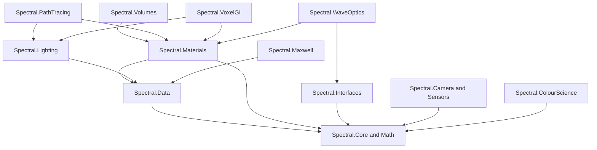

# Spectral: optical and electromagnetic simulation

**Status:** Design target
**Sources:** `physics/optical-foundation.md`, `physics/rendering-and-voxel-gi.md`

Spectral is a hybrid spectral light-transport and optical-simulation platform.
It combines practical rendering with measured material data, coherent wave
models, voxel global illumination, and optional full-field electromagnetic
solvers.

The engine must distinguish visual plausibility from physical validity. A
texture is not a complete physical material, and a cached approximation is not
an exact electromagnetic solution.

## Fidelity regimes

| Regime | Use | Preserved quantities |
| --- | --- | --- |
| Geometric spectral optics | Production rendering | Wavelength, radiance, Fresnel, dispersion, absorption, scattering |
| Coherent wave transport | Interference and diffraction | Complex amplitude, phase, coherence, polarization |
| Full-field solving | Wavelength-scale specialist problems | Electromagnetic fields, constitutive models, boundary conditions |

The regimes share units, scene data, materials, and validation infrastructure,
but do not silently substitute one algorithm for another.

## Module boundaries



Physical models define equations and data contracts. Integrators decide when
to invoke them. Backends decide where to execute them. Workbench must never
become a dependency of runtime material or transport modules.

## Physical data

Use SI units internally where practical:

| Quantity | Unit |
| --- | --- |
| Wavelength | metres |
| Frequency | hertz |
| Wavenumber | radians/metre |
| Phase | radians |
| Refractive index and extinction coefficient | dimensionless |
| Radiance | documented spectral power units |
| Absorption/extinction coefficient | inverse metres |

Material data can be analytic, tabulated, measured, or layered. Every source
records provenance, valid ranges, measurement conditions, interpolation rules,
uncertainty, and conversion history.

## Core models

The baseline model library includes:

- Snell refraction and geometric reflection.
- Fresnel reflection/transmission.
- Cauchy and Sellmeier dispersion.
- Complex refractive index and Beer–Lambert absorption.
- BRDF/BSDF and microfacet scattering.
- Polarization using Jones or Stokes/Mueller representations.
- Volume extinction, scattering, and emission.
- Spectral rendering-equation integration.
- Phase, coherence, interference, thin-film, and diffraction models.

The API must make approximation regime explicit. Standard radiance transport
must not claim to preserve phase, and a diffuse cache must not be used for a
coherent experiment.

## Image formation

Camera and sensor models are part of physical output. Record aperture, exposure,
spectral sensor response, colour matching functions, display transform, white
point, and tone mapping. A rendered RGB image without output metadata is not a
measurement-grade result.

## Validation

Minimum validation includes analytic Fresnel, absorption, dispersion,
polarization, volume, emission, convergence, energy conservation, and measured
material cases. Approximate systems report error, runtime, memory, cache age,
confidence, and validity regime against an independent reference path tracer.

## Experimental contracts

All spectral results use the conventions and validity records in `physics/`.
Experiments must pin an Atlas snapshot, model catalog version, material-data
manifest, solver settings, camera/sensor response, random seed, and output
hash. The result schema is:

```json
{
  "schema": "spectral.result/1",
  "observable": "radiance",
  "units": "W m-2 sr-1 m-1",
  "wavelength_m": [0.00000045, 0.00000055],
  "values": [/* ... */],
  "model": "fresnel-dielectric-v1",
  "scene_revision": "sha256:…",
  "uncertainty": {"standard": 0.001, "coverage": 0.95},
  "validity": "pass"
}
```

Camera output additionally records spectral sensitivity, exposure, white point,
transfer function, and color-space metadata; an RGB PNG without that context
is not a physical measurement. Full-field outputs record boundary conditions,
mesh, time step, residual, and energy balance. See the research workflow and
validation protocol before adding a new backend.

## Proof obligations and failure semantics

Each observable has a dimensional check before evaluation: radiance declares
its spectral measure, extinction is inverse metres, phase is dimensionless,
and wavelength/frequency conversions use the serialized convention. Passive
interfaces must satisfy `R + T + A = 1` (within uncertainty), BRDFs satisfy
reciprocity and non-negative hemispherical reflectance, and volume transport
does not create energy unless an emission term is present. Polarization tests
preserve the Stokes physicality bound `S0 >= sqrt(S1^2 + S2^2 + S3^2)`.

Refinement increases samples, spatial resolution, or temporal resolution until
the observable's confidence interval and discretization estimate satisfy the
manifest. FDTD uses a Courant-safe time step; iterative solvers report residual,
conditioning, stagnation, and iteration limit. Uncertainty propagation keeps
material, calibration, statistical, and numerical contributions separate and
uses covariance or a conservative bound when independence is not justified.
An out-of-regime, missing-data, non-finite, energy-balance, or non-converged
case returns a typed failure (`SPC_UNSUPPORTED_REGIME`, `SPC_INVALID_DATA`,
`SPC_NONCONVERGED`, or `SPC_INVARIANT`) unless the caller explicitly permits
an approximation-with-warning.

CPU and GPU reference scenes share canonical inputs, seeds, sample counts, and
measurement definitions. Bitwise equality is required for deterministic
fixtures; stochastic GPU paths use confidence intervals and physical
tolerances, while reporting device, driver, precision, reduction mode, and
fast-math settings. Adversarial coverage includes zero-width spectra, grazing
incidence, total internal reflection, negative/complex-index edge cases,
sub-wavelength geometry, denormal values, empty lights, saturated sensors,
degenerate triangles, missing cache bricks, and extreme dynamic range.

Apply the shared [numerical robustness](../../research/numerical-robustness.md)
and [adversarial/reference scene suite](../../research/adversarial-reference-scenes.md)
before accepting a backend as a reference implementation.
